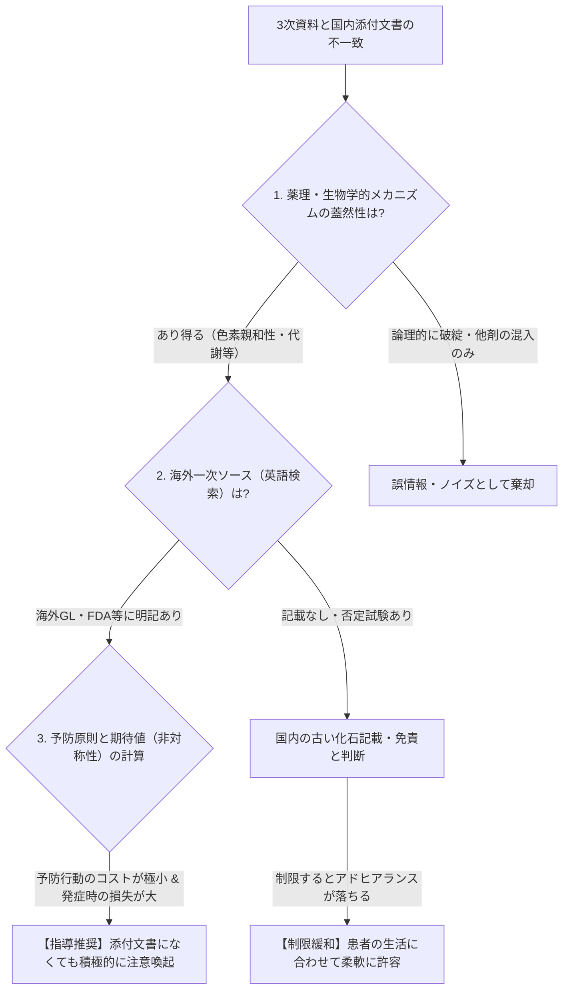

# 医療ナレッジ統合パック（exaBase投入用）

- 構成：README.md、tier_matrix.md、KNOWLEDGE_EXPANSION_1023.md、KNOWLEDGE_EXPANSION_1026.md
- 注意：参考情報です。用量・換算値・禁忌は必ず1次資料（添付文書・IF・ガイドライン）で確認してください。
- URLは1行の完全な形に結合済み。`🔍未検証` は1次資料での裏取り前を示す。


---

<!-- 出典ファイル: README.md（カテゴリ別ナビ） -->

# clinical-knowledge-portal

## 🧭 ナレッジ早見ナビ（カテゴリ別リンク）

| カテゴリ | 収録先 | 主な内容 |
| :--- | :--- | :--- |
| **臨床注意ティア・ギャップ事例** | [tier_matrix.md](tier_matrix.md) | 肝機能ティア表、建前×本音の事例集（RFP・鉄剤） |
| **PMDA深層リンク** | [KNOWLEDGE_EXPANSION_1026.md](KNOWLEDGE_EXPANSION_1026.md)（§1） | 重篤副作用マニュアル、公知申請品目、OTC版DSU、MID-NET |
| **病院DIティア表** | [KNOWLEDGE_EXPANSION_1026.md](KNOWLEDGE_EXPANSION_1026.md)（§2） | 愛媛大・JCHO熊本ほか |
| **吸入指導・デバイス** | [KNOWLEDGE_EXPANSION_1026.md](KNOWLEDGE_EXPANSION_1026.md)（§3）／[1023](KNOWLEDGE_EXPANSION_1023.md)（§4） | 吸入三種の神器、**CloseDi（旧：さがすDI）**、開封後期限 |
| **検査値×生活工夫・費用** | [KNOWLEDGE_EXPANSION_1026.md](KNOWLEDGE_EXPANSION_1026.md)（§4） | 検査値ガイド、腎臓病食、インスリンポンプ費用 |
| **文献・著作権・エビデンスレベル** | [KNOWLEDGE_EXPANSION_1026.md](KNOWLEDGE_EXPANSION_1026.md)（§5） | 二次利用ルール、Minds、疑義解釈 |
| **疾患解説・処方逆引き・パス・レジメン** | [KNOWLEDGE_EXPANSION_1023.md](KNOWLEDGE_EXPANSION_1023.md)（§1〜3） | DTCの死角、COPD/喘息逆引き、がんレジメン公開病院 |
| **製薬HCP・ヒヤリハット・マスタ・統計** | [KNOWLEDGE_EXPANSION_1023.md](KNOWLEDGE_EXPANSION_1023.md)（§5〜7） | PhindMI、供給状況、救急3階層、シンクタンク |
| **開発ロードマップ** | [ROADMAP.md](ROADMAP.md) | 優先課題・TODO・ガントチャート |
| **AI共通ルール・連携** | [CLAUDE.md](CLAUDE.md) / [project_manifest.json](project_manifest.json) | 複数リポジトリ間のLLM連携 |
| **運用ファイル** | [wishlist.md](wishlist.md) / [CHANGELOG.md](CHANGELOG.md) / [STATUS_REPORT.md](STATUS_REPORT.md) / [docs/development_log.md](docs/development_log.md) | 依頼の棚卸しと達成率、更新記録、業務報告、設計メモ |
| **公開用ビュー** | [docs/index.html](docs/index.html) | 検索・タブ付き単一HTML（GitHub Pages用） |

---

---

<!-- 出典ファイル: tier_matrix.md（臨床注意ティア表・ギャップ事例） -->

# ⚖️ 臨床注意レベル（ティア表）＆ ギャップ構造化アーカイブ

- **記載日**：2026-10-20 / **最終更新日**：2026-10-20
- **目的**：添付文書（法律上の免責書類）の「白か黒か」の記載をそのまま現場に持ち込んでマトを外すのを防ぐため、「発現の予測性」と「社会・治療へのインパクト」の2軸で臨床上のリアルな注意レベル（Tier 1〜3）を定義する。

---

## 1. 肝機能に影響を及ぼす薬の「注意レベル（ティア表）」基準

| ティア | 臨床の位置づけ・特徴 | 1次資料（添付文書）のシグナル | 現場での必須アクション（匙加減） | 主な該当薬 |
| :--- | :--- | :--- | :--- | :--- |
| **🏆 Tier 1**<br>（最重警戒） | **予測可能・高リスク**<br>飲酒や体質に関わらず高確率で肝機能が低下する、または発現時の致死率が極めて高い。定期採血が義務化。 | 【警告】や【重要な基本的注意】の最上位に**「投与開始後〇ヶ月は月に〇回検査すること」**と具体的に指定。 | ・医師が診察中に必ず言う「禁酒」「定期採血」を薬局でも強力にサポート。<br>・採血確認や検査オーダーが漏れていれば**疑義照会・トレーシングレポートの絶対対象**。 | ・リファンピシン（抗結核薬）<br>・イトラコナゾール<br>・アセトアミノフェン（高用量）<br>・一部の抗がん剤 |
| **🥈 Tier 2**<br>（中警戒） | **予測不能（特異体質性）**<br>薬自体の毒性ではなく、遺伝的体質やアレルギーで「いつ・誰に起きるか予測できない」肝障害。 | 【重大な副作用】に「劇症肝炎、肝機能障害（0.1%未満、または頻度不明）」と記載。定期検査の頻度指定までは無い。 | ・全員への採血強制は不要。<br>・代わりに患者全員へ**「初期症状のシグナル（強いだるさ、白目が黄色い、尿が濃い茶色）」**だけを端的に教育する。 | ・抗菌薬全般（オーグメンチン等）<br>・NSAIDs（ロキソプロフェン等）<br>・一部の抗てんかん薬 |
| **🥉 Tier 3**<br>（低警戒） | **長期・蓄積・脂肪肝性**<br>短期では問題ないが、何年も漫然と飲み続けることで代謝に無理が生じ、ゆっくり数値が上がるレベル。 | 【その他の副作用】等に「AST/ALT上昇」と記載。急激な劇症化リスクは極めて低い。 | ・初回指導で肝障害を強調して**服薬恐怖（アドヒアランス低下）を招かないこと（マト外れ防止）**。<br>・年1〜2回の健診や定期受診の採血で十分キャッチアップ可能。 | ・スタチン系（脂質異常症薬）<br>・ステロイド剤の長期内服 |

---

## 2. 【実践アーカイブ】建前（1次資料）と本音（臨床）のギャップ事例集

## 0. 「情報の不一致」を15秒で裁く3ステップ・アルゴリズム
3次資料（ネット記事や医師の発言）と日本の1次資料（添付文書）が食い違った際、「単なる誤情報（混入）」か「日本の添付文書の遅れ（隠れた本質リスク）」かを以下の手順でパースする。



---

### Case 01（改訂版）：リファンピシン（RFP）と「日光過敏症」― 反転からの反転を防ぐデータパース
- **記載日**：2026-10-20 / **更新日**：2026-10-21
- **臨床注意ティア**：🏆 Tier 1（肝機能・最重警戒）＋ 🛡️ 予防原則適用（日焼け対策）
- **検証ステータス**：🟢 解決済（国内添付文書のスコープ外にある「海外標準リスク＆生物学的蓋然性」として統合）

#### ① 医師が診察中に必ず言うこと（現場のコア指導）
*   **「肝機能低下のリスクがあるため、服用中は禁酒」**（東京都保健医療局 DOTS資料）
*   **「外出時は普通の日焼けにも注意（日焼け止め・長袖の活用）」**（神戸きしだクリニック解説 等）

#### ② なぜ「二転三転（混入疑惑→実は妥当）」が起きるのか？（3ステップ検証）
1.  **初期バイアスの罠（情報の局所性）**：
    日本の添付文書に「光線過敏症」の明記がないため、一見すると「併用薬（ピラジナミド等）の副作用がWeb記事に誤って混入しただけ」に見えてしまう。
2.  **ステップ① 海外一次ソースへのジャンプ（`Rifampicin photosensitivity`）**：
    英語圏の公的ガイドライン（国境なき医師団［MSF］の結核ガイドライン等）を牽くと、リファンピシン単剤の副作用として「Photosensitivity（光線過敏症）」および直射日光の回避・サンスクリーン使用が明記されている。日本のPMDAの記載がすべてではない。
3.  **ステップ② メカニズムの生物学的妥当性**：
    RFPは尿・汗・涙を赤橙色に染めるほど全組織への移行性と色素親和性（クロマトフォア等への影響）が極めて高い。皮膚組織に色素代謝物が存在する以上、紫外線（日光）が局所免疫応答や皮膚負担のトリガーになることは生物学的に極めて自然である（特に増量期や発疹既往がある場合）。
4.  **ステップ③ 予防原則（ダメージの非対称性）による意思決定**：
    *   *言わずに薬疹・火傷が起きた場合*：本丸である結核治療が中断する（**損失：極大**）。
    *   *日焼け注意と伝えて何も起きなかった場合*：患者が日焼け止めを塗る手間のみ（**侵襲・デメリット：ゼロ**）。
    *   **結論**：国内添付文書の枠に縛られず、窓口で「日焼けにも注意してください」と伝えることは医療者の裁量として極めて適切かつ合理的である。

#### ③ 現場でのキラーフレーズ（患者さん向け）
*   「お薬が肝臓で代謝されるため治療中はお酒をお休みしてくださいね。また、このお薬は尿や汗がオレンジ色になるくらい全身の組織にしっかり届く性質があります。そのぶん、お肌も日光（紫外線）に少し敏感になって日焼けや発疹が出やすくなることがあるので、外出時は日焼け止めを塗ったり長袖を着たりして、お肌も守ってあげてくださいね」

### Case 01：リファンピシン（RFP）の必須指導と「3次資料の混入トラップ」
- **記載日**：2026-10-20 / **更新日**：2026-10-20
- **臨床注意ティア**：🏆 Tier 1（肝機能・最重警戒）
- **検証ステータス**：🔍 一部疑義あり（3次資料における多剤併用文言の混入）

#### ① 医師が診察中に必ず言うこと（現場のコア指導）
*   **「肝機能低下のリスクがあるため、リファンピシン服用中は禁酒」**
    *   *裏付けソース（公的・準1次）*：東京都保健医療局 DOTS資料 / 結核予防会 解説PDF
    *   *現場でのキラーフレーズ*：「お薬が肝臓で一生懸命処理されるため、肝臓に余計な負担をかけないよう治療中はお酒をお休みしてくださいね。また、おしっこや汗、涙がオレンジ色になりますが、これはお薬そのものの色なのでびっくりしないでくださいね」

#### ② 3次資料の罠（多剤併用療法の文言混入疑惑）
*   *現象*：クリニックの解説ページ（3次資料） にて、リファンピシンの注意点として「日光過敏症（外出時は日焼け止めや長袖着用が必要）」との記載を発見。
*   *臨床的考察*：結核の標準治療（HREZ：イソニアジド、リファンピシン、ピラジナミド、エタンブトール）において、典型的な光線過敏症を起こすのは主に**ピラジナミド（PZA）**である。Web記事作成時に「抗結核薬全体の生活指導」がRFP単剤の解説に混入した可能性が高い。ただしRFPでも重篤な薬疹（TEN/SJS等）は起こり得るため、皮膚への注意自体は否定しない。
*   🎯 **検証の狙い目（1次資料での確認ポイント）**：
    *   リファンピシンおよびピラジナミドの「添付文書（副作用：皮膚・過敏症）」および「インタビューフォーム（項目別副作用発現頻度）」を直接比較し、光線過敏症の記載有無を確定させる。

---

### Case 02：鉄剤と「お茶で飲んでいい説」の裏事情
- **記載日**：2026-10-20 / **更新日**：2026-10-20
- **臨床注意ティア**：🥉 Tier 3相当（アドヒアランス最優先・柔軟許容）
- **検証ステータス**：🟢 解決済（1次資料の化石記載と臨床データの乖離を確認）

#### ① 現場の結論（マトを外さない判断基準）
*   **「多少お茶で飲んでも治療効果に致命的な影響はないため、目くじらを立てて禁じる必要はない」**
*   **医師の思考**：お茶を避けるために飲むタイミングを逃し、服薬コンプライアンスが落ちることの方が貧血治療において圧倒的に不利益である。

#### ② 「建前」と「本音」のギャップ構造
| 視点 | 内容・記載 | ギャップが生じる構造的理由 |
| :--- | :--- | :--- |
| **📜 1次資料（建前・免責）**<br>※添付文書 | ・**クエン酸第一鉄（フェロミア等）**：「お茶NG」の記載は**最初からない**。<br>・**硫酸鉄（フェロ・グラデュメット等）**：「タンニン酸を含有する食品との併用注意」が残存。 | クエン酸第一鉄はキレート構造のためタンニンの影響を受けない。硫酸鉄の記載は「何十年も前の試験管内（in vitro）データ」が改定されずに残っている化石記載。 |
| **🩺 臨床知（本音・実態）**<br>※臨床試験・3次資料 | 臨床試験において「水で服用した群」と「緑茶で服用した群」でヘモグロビン上昇効果に有意差がないことが証明済み。 | 医療用鉄剤は鉄の配合量（100mg等）が圧倒的に多く、一部がタンニンと結合して吸収が落ちても、治療に必要な量は十分に吸収されるため。 |

#### ③ 現場でのアクション（言い方の工夫）
*   🚫 **ダメな指導（1次資料の妄信）**：「添付文書に併用注意と書いてあるので、前後2時間は絶対にお茶やコーヒーを飲まないでください！」
*   ⭕️ **現場でのキラーフレーズ**：「昔は鉄剤とお茶はダメと言われていましたが、今のお薬（特にフェロミアなど）はお茶の影響をほとんど受けません。お水がなくて飲み忘れるくらいなら、手元のお茶や麦茶でサッと飲んでしまって全然大丈夫ですよ！ただ、ものすごく濃い緑茶や玉露のときだけ、念のためお水にしてくださいね」

---

<!-- 出典ファイル: KNOWLEDGE_EXPANSION_1023.md -->

# 🚀 医療ナレッジ拡張パック（2026-10-23 統合分）

- **記載日**：2026-10-23 / **更新日**：2026-10-23
- **収録内容**：疾患啓発（DTC）ギャップ分析、処方逆引き・臨床検査マトリクス、病院レジメン・クリニカルパス、製薬HCP・PhindMI補完リスト、医療安全（ヒヤリハット）・マスタ・救急・シンクタンク総覧

---

## 1. 疾患解説ポータル（DTC）の死角と補完戦略

### 📌 ベースライン：QLife 信頼できる病気解説サイト集
製薬企業の疾患啓発（DTC：Direct to Consumer）サイトを探す際の出発点。食事レシピ、日常生活の工夫（リウマチ患者のボタン掛け等）、医師への相談シートPDFなど「生活動線」の資材が充実している。
```text
https://www.qlife.jp/disease_explanation/
```

### ⚠️ QLife（製薬DTC）で手薄になる「3つの死角」と補完先
1. **ニッチながん種・最新の標準治療**
   → 国立がん研究センター「がん情報サービス」や各病院の公開レジメン一覧で補完する。
2. **ありふれた日常疾患・軽微な症状・初期セルフケア**（風邪、胃腸炎、やけど、創傷被覆材の使い分け等）
   → 地域の専門クリニック発信の良質な解説記事（3次資料）で補完する。
3. **手術のリアルな経過（術式・入院日程）・介護・福祉制度**
   → 先進病院の「クリニカルパス一覧」および自治体の支援ナビで補完する。

---

## 2. 処方薬からの疾患逆引き（リバースマッピング）＆ 臨床制限ルール

### 🎯 疾患による規格・使用制限の早見ルール（確定・除外ロジック）
*   **COPD vs 気管支喘息（吸入ステロイド用量の罠）**
    *   **ルール**：COPDには肺炎リスク回避のため高用量ステロイドを使用しない。
    *   **逆引き判定**：レルベアやテリルジー等はCOPD適応において高用量規格が除外されているため、「レルベア200」が出た時点で（COPDではなく）気管支喘息であると100%類推できる。
*   **慢性心不全における「水分制限」の現代的解釈**
    *   **ルール**：一律の厳しい水分制限は過去の遺物。現在、水分制限が推奨されるのは**「重症心不全」または「低Na血症合併例」に限られる**。
    *   *根拠ソース（東邦大学・心不全CQ）*：
        ```text
        http://hospi.sakura.ne.jp/wp/wp-content/themes/generalist/img/medical/jhn-cq-toho-201019.pdf
        ```
*   **使用にあたり検査（術前スクリーニング・定期モニタリング）が必須の医薬品（Tier 1群）**
    *   **該当例**：ゼルヤンツ、アクテムラ、シムジア、プラリア等（B型肝炎再活性化、結核、低Ca血症等のスクリーニング）。
    *   *根拠ソース（東京都病院薬剤師会 資料）*：
        ```text
        https://www.thpa.or.jp/sites/default/files/Need%20inspection.pdf
        ```

### 🛤️ 疾患軌道（クリニカルパス・頻出シナリオの舗装）
大半の患者が通る標準ルート（妊娠高血糖でのインスリン導入、甲状腺機能低下症でのチラーヂン開始、ケモ中の血糖管理など）はあらかじめ指導動線を舗装しておく。

| 領域・シナリオ | 運営主体・解説タイトル | 検証・参照URL（スラッシュ改行） |
| :--- | :--- | :--- |
| **門前・クリニカルパス** | 佐久総合病院（本院・医療センター）クリニカルパス一覧（入院から退院までの全工程表） | http://www.sakuhp.or.jp/ja/honin/2863/000199.html<br>http://www.sakuhp.or.jp/ja/center/2896/003121.html |
| **小児用量・監査** | 湘南鎌倉総合病院 薬剤部「小児薬用量一覧」PDF | https://www.skgh.jp/wp/wp-content/themes/skgh/department/pharmacy/for-pharmacist/pdf/pediatric-dose.pdf |
| **ケモ×糖尿病管理** | J-STAGE：化学療法時にインスリン治療を必要とする糖尿病患者のケアシステム導入 | https://www.jstage.jst.go.jp/article/jaden/22/1/22_1/_pdf/-char/ja |
| **睡眠薬・休薬GL** | 日本睡眠学会：睡眠薬の適正な使用と休薬のための診療ガイドライン | https://jssr.jp/files/guideline/suiminyaku-guideline.pdf |
| **小児OSA（無呼吸）** | J-STAGE：小児閉塞性睡眠時無呼吸（OSA）ガイドライン | https://www.jstage.jst.go.jp/article/orltokyo/59/6/59_282/_pdf/-char/ja |
| **感染症・MRSA** | 国立健康危機管理研究機構（JIHS）：MRSA感染症 詳細情報 | https://id-info.jihs.go.jp/infectious-diseases/mrsa-infection/detail/index.html |
| **コロナ治療・管理** | 地域医療機能推進機構（JCHO）中央病院 コロナ関連資料 | https://chuo.kcho.jp/data/media/uploads/2025/02/241c46052b6ead77d31cf9fae3df31ff.pdf |

---

## 3. 病院薬剤部・がんレジメン・副作用パンフ公開リスト
※近年は薬機法・広告規制の観点から病院発信のDIニュース（PDFアーカイブ）は非公開化が進んでいるが、「がんレジメン」と「患者向け副作用パンフレット」は保険薬局連携のため公開されているケースが多い（狙い目）。

| 病院名（運営主体） | 公開状況・強み | 参照URL（スラッシュ改行） |
| :--- | :--- | :--- |
| **国立がん研究センター中央病院** | **【最強】** 薬剤部トップ、レジメン一覧、および**「レジメンごとの副作用情報パンフ」**まで完全公開 | https://www.ncc.go.jp/jp/ncch/division/pharmacy/index.html<br>▼レジメン：`.../040/regimen/index.html`<br>▼副作用パンフ：`.../010/pamph/index.html` |
| **虎の門病院**（国家公務員共済） | DIアーカイブは非公開だが、**化学療法レジメンPDF**は公開あり | https://toranomon.kkr.or.jp/cms/departments/pharmaceutical/<br>▼レジメンPDF：`.../files/1.pdf` |
| **慶應義塾大学病院** | 腫瘍センターにて医療従事者向けレジメン情報を公開 | https://cancercenter.med.keio.ac.jp/medical_info/ |
| **東京女子医大 足立医療センター** | 保険薬局向けページにレジメン一覧を公開 | https://twmu-amc.jp/mce/pharmacy/insurance-pharmacy/regimen.html |
| **東京品川病院** | 薬剤部ページにてレジメン公開 | https://tokyo-shinagawa.jp/department/section/10 |
| **清水病院 / GI-Cancer** | 消化器がん副作用対策・病院資料 | https://gi-cancer.net/gi/fukusayo/fukusayo_01_2.html<br>https://www.shimizuhospital.com/dist/wp-content/uploads/2012/07/ab042786a41445a542f8654b0b62520e-1.pdf |

---

## 4. デバイス管理・開封後期限・日常疾患の「現場回答（3次資料）」

患者から窓口で聞かれる「いつまで使える？」「どう捨てる？」「何歳まで続く？」に即答するための実務リンク群。

### 💉 デバイス（吸入器・インスリン・エピペン）の期限・保管・廃棄
*   **吸入器の指導・一覧**（坂戸市薬剤師会資料 / 杏林製薬 開封後期限FAQ）：
    ```text
    https://www.sakakodo.com/download/document/110315inhaler.pdf

    https://www.kyorin-pharm.co.jp/prodinfo/faq/details/003615/
    ```
*   **インスリン製剤の保管・スキルアップ・医療廃棄物**（ノボノルディスク公式 / 福井県内科医会PDF）：
    ※医療廃棄物（針・インスリン本体）は「一般論」「自治体・薬局ルール（廃棄袋管理表）」「メーカー1次資料」を分けて案内する。
    ```text
    https://www.novonordisk.co.jp/products/how-to/injection/how-to/storage.html

    https://www.fukui-naikaikai.com/img/2019/11/SkillupDM-No.79.pdf
    ```
*   **⭐️ エピペン・小児喘息の長期見通し**（環境再生保全機構 ERCA / かくむクリニック / こどもの喘息）：
    ```text
    https://www.erca.go.jp/yobou/zensoku/sukoyaka/column/202102_2/

    https://kakumu-cl.jp/childhoodasthma.html

    http://www.kodomo.co.jp/asthma/index.htm
    ```

### 🩺 クリニック発信の良質解説（検査工程・処置・ボリュームゾーン把握）
*   **創傷処置（キズパワーパッド等の湿潤療法を避けるべきケース）**（さいたま外科）：
    ```text
    https://saitamageka.com/wound/
    ```
*   **皮膚科（ベピオゲルの使い方・刺激対策）**（巣鴨千石皮ふ科）：
    ```text
    https://sugamo-sengoku-hifu.jp/medicines/bepio.html
    ```
*   **整形・疼痛（石灰沈着性腱板炎：30〜60代女性に多い等の疫学）**（オクノクリニック / 頭痛ーる：片頭痛MHI・HITスコア）：
    ```text
    https://okuno-y-clinic.com/itami_qa/calcific_tendinitis.html

    https://zutool.jp/column/basic/post-26257
    ```
*   **耳鼻科・呼吸器（長引く咳、急性扁桃炎、鼻疾患、舌下免疫療法、検査費用目安）**：
    ```text
    http://yoshi-ent.jp/

    https://ebina-kojiro.com/course/c18/

    https://kumagaijibika.com/nose-symptoms-diseases

    https://ooimachi-jibika.com/

    https://nagatomo-ent.jp/examination-fees
    ```
*   **消化器・肝臓・透析・画像検査（ピロリ菌検査工程、B型肝炎、透析患者の熱中症、X線被曝）**：
    ```text
    https://ohkura-naika.jp/helicobacter_pylori.html

    http://nakata-cl.jp/hepatitis_b.html

    https://www.toseki.tokyo/blog/touseki-nechushou/

    https://www.aichi-med-u.ac.jp/hospital/sh15/sh1503/sh150301/sh15030101/sh15030101_16.html
    ```

---

## 5. 製薬企業HCP（医療従事者向け）横断検索 ＆ 資材発注ハブ

### 🔍 PhindMI（製薬協連携・医薬品情報横断検索）の現在地と限界
BIPROGY運営。2026年5月時点で**15社**（第一三共、アステラス、中外、大塚、ファイザー、AZ、杏林、キッセイ、大鵬、大正、帝人、メルク、旭化成、塩野義※資材のみ、小野※資材のみ）が参加。
⚠️ **注意**：武田薬品、エーザイ、MSD、ノバルティス、サノフィ等の大手は未参加のため、PhindMI単体では網羅できない。
```text
https://www.phindmi.com/FAQ/GFAQ01M01.aspx
```

### 🏢 製薬企業・資材オーダー・RMP・くすりのしおり連携マスタ
2026年6月末時点で約2,000のRMP・指導資材が約3,600の「くすりのしおり」に連携済み。容器のGS1バーコードはアプリ「添文ナビ」で即座に添付文書へアクセス可能。

| カテゴリ・企業名 | 用途・特徴（HCPサイト名・格納階層） | URL（スラッシュ改行） |
| :--- | :--- | :--- |
| **製薬協（JPMA）** | 加盟企業リンク一覧 ＆ くすり相談窓口一覧 | https://www.jpma.or.jp/about/member/company/index.html<br>https://www.jpma.or.jp/information/consumer/contact/index.html |
| **RAD-AR（くすりのしおり）** | 資材連携ニュース ＆ 活用サービス一覧 | https://www.rad-ar.or.jp/topics/post?id=e1dbde9439666367a40002b6<br>https://www.rad-ar.or.jp/siori/about/users/ |
| **杏林製薬（モデルケース）** | HCP：Kyorin Medical Bridge（ドクターサロン、アポトーク、RMD資材、リフヌア等製品サイト） | https://www.kyorin-medicalbridge.jp/library/apotalk/<br>https://www.med.kyorin-rmd.com/material/<br>https://www.lyfnua.jp/ |
| **ニプロ / 丸石 / シスメックス** | 資材オーダー（ニプロ）、医療ナレッジ（丸石）、プライマリケア・皮膚検査（シスメックス） | https://order.nipro.co.jp/items<br>https://www.maruishi-pharm.co.jp/medical/newsrelease?news-type=knowledge<br>https://primary-care.sysmex.co.jp/hcp/ |
| **バイオシミラー** | バイオシミラー協議会 解説PDF | https://www.biosimilar.jp/pdf/taidan2.pdf |

---

## 6. 医療安全（ヒヤリ・ハット）・供給状況・公的コードマスタ・特別領域

### 🚨 薬局ヒヤリ・ハット事例（1次公文書 vs 3次解説）
毎年秋（9月末〜10月初頭）に前年分の「年報」が公表される恒例スケジュール。
*   **【1次資料】日本医療機能評価機構（公式公文書・疑義照会事例・年報）**：
    ```text
    https://www.yakkyoku-hiyari.jcqhc.or.jp/contents/yearreport/index.html

    https://www.yakkyoku-hiyari.jcqhc.or.jp/contents/sharing_case/category_gigi.html
    ```
*   **【3次解説】GemMed（医療制度・ヒヤリハット報告書の高速要約）** / **Medi-UP**：
    ```text
    https://gemmed.ghc-j.com/

    https://mediklect.co.jp/medi-up/about-medi-up/
    ```

### 📊 医薬品供給状況・公的マスタデータベース（データパイプライン用）
| 種別 | サイト名 | URL（スラッシュ改行） |
| :--- | :--- | :--- |
| **出荷調整・供給不足** | ・SCUEL DATA（医薬品供給情報）<br>・DrugShortage.jp | https://scueldata.me/ph/<br>https://drugshortage.jp/index.php |
| **薬価・HOT・JANマスタ** | ・診療報酬情報提供サービス（厚労省）<br>・医薬品HOTコードマスター（MEDIS）<br>・日本医薬品一般的名称（JAN）DB<br>・基本マスター（HPDX） | https://shinryohoshu.mhlw.go.jp/shinryohoshu/searchMenu/doSearchInputYp<br>https://www2.medis.or.jp/hcode/<br>https://jpdb.nihs.go.jp/jan/<br>https://www.hpdx.or.jp/smph/seikyushiharai/tensuhyo/kihonmasta/r06/kihonmasta_04.html |
| **OTC・妊産婦・ドーピング** | ・日本一般用医薬品連合会 / OTC版DSU<br>・国立成育医療研究センター（授乳と薬）<br>・日本スポーツ協会（アンチ・ドーピング） | https://www.jsmi.jp/<br>https://www.jfsmi.jp/dsu_info.html<br>https://www.ncchd.go.jp/kusuri/lactation/<br>https://www.japan-sports.or.jp/medicine/doping/tabid537.html |

---

## 7. マクロ医療統計・疾患レジストリ・救急医療3階層・シンクタンク

### 🚑 救急医療の3階層（一次・二次・三次救急）と地域医療情報
患者調査では「未受療の潜在患者（高血圧や喘息など）」が把握できない点に留意しつつ、地域の三次救急（救命救急センター）や大規模疾患レジストリ（心不全のWET-HF：慶應・榊原記念・聖路加など東京近郊11施設、全国がん登録、日本脳卒中データバンク、整形外科JOANR、難病RADDAR-J）のネットワークを把握しておく。

```text
# 医療情報ネット「ナビイ」（旧ひまわり移行先）
https://www.iryou.teikyouseido.mhlw.go.jp/znk-web/juminkanja/S2300/initialize

# 厚生労働省・日本救急医学会・東京都：救命救急センター設置状況＆マップ
https://www.mhlw.go.jp/stf/newpage_32614.html

https://www.jaam.jp/about/shisetsu/qq-center.html

https://kyumei-map.pages.dev/

# 防災・福祉支援（ハザードマップポータル / Tokyo支援ナビ / 奈良県立医大おすすめリンク集）
https://disaportal.gsi.go.jp/

https://www.support-navi.metro.tokyo.lg.jp/top

https://www.naramed-u.ac.jp/library/linkshu/osusume.html
```

### 🧠 医療政策・ヘルスケアDX シンクタンク（制度改定・トレンド予測の狙い目）
調剤報酬改定や2027年以降のOTC類似薬・医療DXの動向を先読みするためのレポート群。
*   **野村総合研究所（NRI）**：https://www.nri.com/jp/knowledge/report/list.html
*   **ニッセイ基礎研究所（医療・介護）**：https://www.nli-research.co.jp/report_category/tag_category_id=41?site=nli
*   **その他注目シンクタンク（検証候補）**：三菱総合研究所（MRI：医療DX・予防）、みずほリサーチ＆テクノロジーズ（厚労省受託調査・データヘルス）、日本総合研究所（地域医療・社会保障）、日本医療政策機構（HGPI：AMR・がん・メンタルヘルス提言）。

---

<!-- 出典ファイル: KNOWLEDGE_EXPANSION_1026.md -->

# 🚀 医療ナレッジ拡張パック 第2弾（PMDA深層・病院DIティア・検査・吸入統合）

- **記載日**：2026-10-26 / **最終更新日**：2026-10-26
- **収録内容**：PMDAパンくず経路付き深層リンク、病院薬剤部DIティア表、検査値×生活工夫、吸入指導コアサイト、著作権・二次利用ルール

---

## 1. PMDA（医薬品医療機器総合機構）深層ダイレクトリンク集
トップページから辿ると迷子になりやすい重要階層を、パンくず経路付きでピン留め。

### 🛡️ 重篤副作用疾患別対応マニュアル ＆ 適正使用・注意喚起
*   **重篤副作用疾患別対応マニュアル（医療関係者向け / 患者・一般向け / ICI専用）**
    *   *経路*：`PMDAホーム ＞ 安全対策業務 ＞ 情報提供業務 ＞ 医薬品 ＞ 副作用等情報`
    *   *強み*：「初期症状のシグナル（Tier 2指導用）」と「発症時の救急対応・連絡先」の公的根拠。特に免疫チェックポイント阻害薬（ICI：オプジーボ等）のirAE対応PDFは必携。
    ```text
    # 医療関係者向け一覧
    https://www.pmda.go.jp/safety/info-services/drugs/adr-info/manuals-for-hc-pro/0001.html

    # 患者・一般の方向け一覧
    https://www.pmda.go.jp/safety/info-services/drugs/adr-info/manuals-for-public/0001.html

    # 免疫チェックポイント阻害薬（ICI）専用パンフPDF
    https://www.pmda.go.jp/files/000245271.pdf
    ```
*   **PMDAからの医薬品適正使用のお願い（患者向け）＆ くすり相談Q&A**
    *   *経路*：`安全対策業務 ＞ 情報提供業務 ＞ 医薬品 ＞ 注意喚起情報`（例：チャンピックス錠の意識障害・運転注意等）
    ```text
    # 医薬品情報提供トップ
    https://www.pmda.go.jp/safety/info-services/drugs/0001.html

    # くすりQ&A（患者・一般向け相談窓口）
    https://www.pmda.go.jp/safety/consultation-for-patients/on-drugs/qa/0014.html

    # 適正使用のお願い例（チャンピックス PDF）
    https://www.pmda.go.jp/files/000273433.pdf

    # OTC版DSU（日本一般用医薬品連合会発行・PMDA掲載分）
    https://www.pmda.go.jp/safety/info-services/drugs/calling-attention/otc-dsu/0001.html
    ```
*   **保険適用される「公知申請品目」に関する情報**
    *   *経路*：`承認審査関連業務 ＞ 審査関連情報 ＞ 保険適用される公知申請品目`
    *   *強み*：**「添付文書上は適応外だが、保険審査上は認められている処方」**の裏取り（マト外れな疑義照会を防ぐ最重要1次ソース）。
    ```text
    https://www.pmda.go.jp/review-services/drug-reviews/review-information/p-drugs/0016.html
    ```
*   **MID-NET（医療情報データベース）**
    *   *用途*：国内9協力医療機関の電子カルテ・レセプト・DPC統合DB。公開されている「調査結果報告書」から、実臨床での処方実態や副作用発現率のリアルデータを把握する。

---

## 2. 病院薬剤部「DIアーカイブ・レジメン」ティア表（公開性・実用性順）

| ティア | 病院名・サイト名 | 公開コンテンツの特徴・強み | URL（スラッシュ改行） |
| :--- | :--- | :--- | :--- |
| **🏆 Tier S** | **愛媛大学医学部附属病院 薬剤部** | 「DIニュース」のバックナンバーが豊富に公開されており、新薬や同効薬比較の質が極めて高い。 | https://www.hsp.ehime-u.ac.jp/medicine/di_news/ |
| **🏆 Tier S** | **JCHO 熊本総合病院 薬剤部** | 薬薬連携およびDI情報の発信が充実。現場目線のまとまった資料が取得可能。 | https://kumamoto.jcho.go.jp/pharm2/pharmacy2/ |
| **🥈 Tier A** | **東京女子医科大学病院 薬剤部 / 腎臓病総合医療センター** | 薬薬連携ページにて**最新がんレジメン（2025年版PDF等）**を公開。腎臓センターの「腹膜透析」解説も秀逸。 | http://www.twmu.ac.jp/pha/renkei.html<br>http://www.twmu.ac.jp/pha/regimen2025.pdf<br>https://www.twmu.ac.jp/NEP/hukumaku-toseki.html |
| **🥈 Tier A** | **厚木市立病院 薬剤部** | 保険薬局向けの連携情報・採用薬・レジメン関連情報を公開。 | https://www.atsugicity-hp.jp/?page_id=46182 |
| **🥉 Tier B** | **慶應義塾大学病院「KOMPAS」** | 大学病院の専門医が執筆・監修する日本最高峰の医療・健康情報サイト（処方意図・標準治療の理解に最適）。 | https://kompas.hosp.keio.ac.jp/ |

---

## 3. 吸入指導・デバイス管理の「三種の神器」リンク
吸入指導は日本アレルギー学会「アレルギー総合ガイドライン」等をベースにしつつ、以下の視覚的・実務的サイトを組み合わせる。

1. **『兵庫県喘息死ゼロ作戦』実行委員会（神戸大学医学部附属病院）**
   * デバイスごとの操作方法・指導ポイントの網羅性が全国トップクラス。
   ```text
   https://www.med.kobe-u.ac.jp/asthma/medic/inhalation.html
   ```
2. **高崎健康福祉大学薬学部 臨床薬学研究室（群馬県薬剤師会 吸入指導ページ）**
   * アカデミアと地域薬剤師会が連携した吸入指導の標準ツール・動画・評価表。
   ```text
   https://www.gunyaku.or.jp/public/kyuunyuu/index.html
   ```
3. **実務薬剤師による吸入薬比較・指導コツ（3次資料）**
   * おじさん薬剤師のブログ（吸入カテゴリ整理） / ヤクザイック / **CloseDi（旧：さがすDI）**
   * CloseDiは、ブログ形式から「現場の薬剤師が毎日使える強力な検索ツール・プラットフォーム」へ移行・進化した（旧 `sagasudi.com` の記事は過去資産として参照）。
   ```text
   https://ozisanyakuzaishi.hatsumeiobatchi.com/category1/category13/entry34.html

   https://yakuzaic.com/

   # CloseDi（旧：さがすDI）
   https://closedi.jp/
   ```

---

## 4. 臨床検査値 × 生活工夫・デバイス費用・専門コミュニティ

### 🩸 検査値の解釈から「患者の生活指導」へ繋げるサイト群
*   **検査値ガイド・Q&A（検査会社・健診機関の準1次〜2次ソース）**
    *   同友会（健診検査ガイド） / CRCグループ（検査Q&A ※2024.11更新確認）
    ```text
    https://www.do-yukai.com/kensa-guide/

    https://www.crc-group.co.jp/crc/q_and_a/index.html
    ```
*   **検査値から「一次資料をもとにした生活工夫」への翻訳（大正製薬 Livita / 大正健康ナビ）**
    *   単なる基準値説明にとどまらず、食事や運動の具体的なアクションプランまで言語化されており、窓口での指導フレーズに直結する。
    ```text
    https://brand.taisho.co.jp/contents/livita/236/

    https://www.taisho-kenko.com/special/kenshin-guide/blood05/

    https://www.taisho-kenko.com/disease/653/
    ```

### 🍱 領域特化の生活・費用・患者コミュニティ情報
*   **腎臓病の食事療法**（北海道恵愛会 南一条病院 腎臓病センター）：
    ```text
    http://www.h-keiaikai.or.jp/minamiichijo/kidney-center/diet.html
    ```
*   **インスリンポンプ療法（CSII/SAP）の仕組みと費用比較**（メドトロニック公式 / 清水糖尿病クリニック：頻回注射との自己負担額比較）：
    *   *価値*：患者が最も気にする「実際毎月いくらかかるのか？」という経済的リアリズムに答えるための必須知識。
    ```text
    https://www.medtronic.com/jp-ja/your-health/treatments-therapies/diabetes/therapy.html

    https://shimizu-dm.jp/%E3%82%A4%E3%83%B3%E3%82%B9%E3%83%AA%E3%83%B3%E3%83%9D%E3%83%B3%E3%83%97%E7%99%82%E6%B3%95%E8%B2%BB%E7%94%A8%EF%BC%88%E9%A0%BB%E5%9B%9E%E6%B3%A8%E5%B0%84%E3%81%A8%E3%81%AE%E6%AF%94%E8%BC%83%EF%BC%89
    ```
*   **掌蹠膿疱症（PPP）患者コミュニティ・治療解説**：
    *   ビオチン療法や生物学的製剤、歯科金属アレルギーなど、患者間のリアルな悩みと治療選択肢の把握に。
    ```text
    https://ppp-community.com/treatment/
    ```

---

## 5. エビデンスレベル基準・文献検索・著作権コンプライアンス

### ⚖️ 文献・データベース利用時の「著作権・二次利用ルール」（重要）
ポータルや社内資料を公開・共有する際、以下のコンプライアンス境界線を厳守する。
*   **メディカルオンライン（くすり・プロダクトDBは無料会員可 / 文献は月額サブスク）**
    *   🚫 **NG行為**：ダウンロードした文献PDFの他者への譲渡、テキストをそのまま抽出してWebサイト（Publicリポジトリ等）へ転載すること。
    *   ⭕️ **OK行為**：事実・知見を自分の言葉で消化した「1行解説・臨床判断メモ」の記録、または著作権許諾サービスを通じた正規利用。
    ```text
    https://pha.medicalonline.jp/
    ```
*   **医書.jp（論文サマリー検索・閲覧）** / **PubMed** / **東邦大学・医中誌GLデータベース**
    ```text
    https://webview.isho.jp/search
    ```

### 📏 ガイドラインの「エビデンスレベル・推奨度」の揺らぎ確認用
Minds 2020（ver.3.0：2026年3月31日テンプレート一部更新）を基本としつつ、学会ごとの独自の推奨度定義（例：日本乳癌学会のグレード定義など）の揺らぎを確認するリファレンス。
```text
# 日本乳癌学会 診療ガイドライン（推奨グレード・エビデンスレベルの定義例）
https://jbcs.xsrv.jp/guideline/2022/grade/

# 日本医療機能評価機構（Minds・医療事故情報・薬局ヒヤリハット統括）
https://jcqhc.or.jp/

https://www.med-safe.jp/

# 厚生労働省：調剤報酬・疑義解釈資料（1次ソース PDF例）
https://www.mhlw.go.jp/content/12400000/000615888.pdf
```
