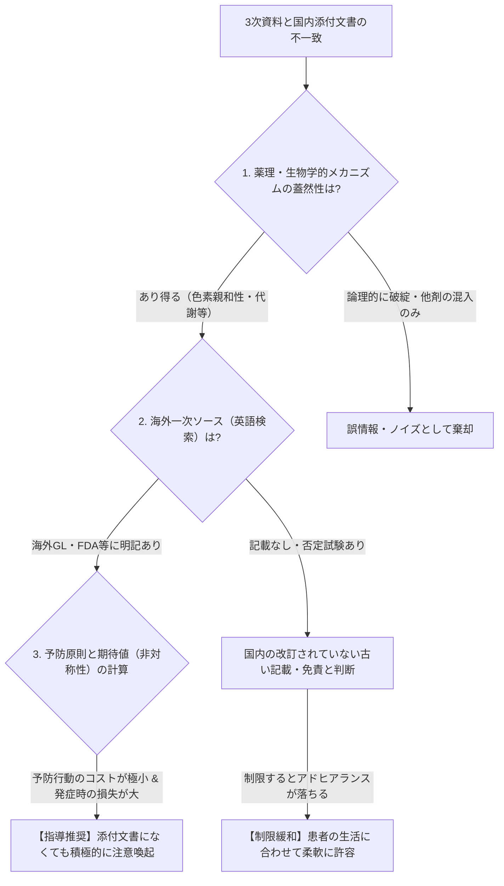

# 医療ナレッジ統合パック（exaBase投入用）

- 構成：README.md、content/01_public_knowledge.md、content/02_original_knowledge.md、content/03_net_knowledge.md、content/04_makers_policy.md、STATUS_REPORT.md、content/details/iron_tea_detail.md、content/details/inhaler_detail.md、content/details/kidney_dose_detail.md
- 注意：参考情報です。用量・換算値・禁忌は必ず1次資料（添付文書・IF・ガイドライン）で確認してください。
- URLは1行の完全な形に結合済み。`🔍未検証` は1次資料での裏取り前を示す。


---

<!-- 出典ファイル: README.md（カテゴリ別ナビ） -->

# clinical-knowledge-portal

## 🧭 ナレッジ早見ナビ（カテゴリ別リンク）

| カテゴリ（HTMLのタブ） | 収録先 | 小項目 |
| :--- | :--- | :--- |
| **🏛️ 1次・公的ナレッジ** | content/01_public_knowledge.md | 1-1 PMDA深層リンク／1-2 診療GL・エビデンスレベル／1-3 医療安全・公的マスタ・供給情報／1-4 救急3階層・レジストリ・行政ナビ |
| **🧠 自作ナレッジ** | content/02_original_knowledge.md | 2-1 3ステップ判定アルゴリズム／2-2 肝機能ティア表／2-3 建前×本音ギャップ事例（RFP・鉄剤）／2-4 処方からの疾患逆引き・臨床制限ルール |
| **🌐 ネット・3次ナレッジ** | content/03_net_knowledge.md | 3-1 病院DI・レジメン・パス（Tier S/A/B）／3-2 吸入「三種の神器」・デバイス管理／3-3 診療科別クリニック解説／3-4 実務薬剤師・検査値翻訳・ニュース・著作権ルール |
| **🏢 メーカー・政策** | content/04_makers_policy.md | 4-1 PhindMI／4-2 RMP・資材・くすりのしおり／4-3 疾患啓発（DTC）の死角と補完／4-4 シンクタンク |
| **🛠️ 自作ツール・安全性** | [STATUS_REPORT.md](STATUS_REPORT.md) | 公開中ツール3件・今後の整備課題・静的ページの安全性 |
| **開発ロードマップ** | [ROADMAP.md](ROADMAP.md) | 優先課題・TODO・ガントチャート |
| **AI共通ルール・連携** | [CLAUDE.md](CLAUDE.md) / [project_manifest.json](project_manifest.json) | 複数リポジトリ間のLLM連携 |
| **運用ファイル** | [wishlist.md](wishlist.md) / [CHANGELOG.md](CHANGELOG.md) / [STATUS_REPORT.md](STATUS_REPORT.md) / [docs/development_log.md](docs/development_log.md) | 依頼の棚卸しと達成率、更新記録、業務報告、設計メモ |
| **公開用ビュー** | [docs/index.html](docs/index.html) | 検索・タブ付き単一HTML（GitHub Pages用） |

---

---

<!-- 出典ファイル: content/01_public_knowledge.md（1次・公的） -->

# 🏛️ 【1次・公的ナレッジ】法規・PMDA・ガイドライン・マスタ

- **統合再編日**：2026-10-26（旧 `KNOWLEDGE_EXPANSION_1023.md` / `1026.md` から「情報の性質」軸で再配置。記載日は各項目の出典に準ずる：2026-10-23 / 2026-10-26）
- **位置づけ**：法律・通知・添付文書・公的機関が発信する **一次〜準一次の根拠** を集めた一覧。判断に迷ったら、最終的にここに戻って根拠を確認する。
- **収録**：PMDA深層リンク／診療ガイドライン・エビデンスレベル／医療安全・公的コードマスタ・供給情報／救急医療3階層・疾患レジストリ・行政ナビ

---

## 1-1. PMDA深層ダイレクトリンク
【1次:公的】 トップページから順にたどると到達しにくい重要なページを、画面の移動経路（パンくず）つきで直接掲載。（旧：10/26統合版 §1）

### 🛡️ 重篤副作用疾患別対応マニュアル ＆ 適正使用・注意喚起
*   **重篤副作用疾患別対応マニュアル（医療関係者向け / 患者・一般向け / ICI専用）**
    *   *経路*：`PMDAホーム ＞ 安全対策業務 ＞ 情報提供業務 ＞ 医薬品 ＞ 副作用等情報`
    *   *強み*：「初期症状のシグナル（【Tier 2】指導用）」と「発症時の救急対応・連絡先」の公的根拠。特に免疫チェックポイント阻害薬（ICI：オプジーボ等）のirAE対応PDFは必携。

- **医療関係者向け一覧** 【1次:公的】 初期症状のシグナルと救急対応の公的根拠（医療関係者向け） → https://www.pmda.go.jp/safety/info-services/drugs/adr-info/manuals-for-hc-pro/0001.html
- **患者・一般の方向け一覧** 【1次:公的】 患者向けの重篤副作用疾患別対応マニュアル → https://www.pmda.go.jp/safety/info-services/drugs/adr-info/manuals-for-public/0001.html
- **免疫チェックポイント阻害薬（ICI）専用パンフPDF** 【1次:公的】 ICI（オプジーボ等）のirAE対応PDF → https://www.pmda.go.jp/files/000245271.pdf

*   **PMDAからの医薬品適正使用のお願い（患者向け）＆ くすり相談Q&A**
    *   *経路*：`安全対策業務 ＞ 情報提供業務 ＞ 医薬品 ＞ 注意喚起情報`（例：チャンピックス錠の意識障害・運転注意等）
    ```text
    # 医薬品情報提供トップ
    https://www.pmda.go.jp/safety/info-services/drugs/0001.html

    # くすりQ&A（患者・一般向け相談窓口）
    https://www.pmda.go.jp/safety/consultation-for-patients/on-drugs/qa/0014.html

    # 適正使用のお願い例（チャンピックス PDF）
    https://www.pmda.go.jp/files/000273433.pdf

    # OTC版DSU（日本一般用医薬品連合会発行・PMDA掲載分）
    https://www.pmda.go.jp/safety/info-services/drugs/calling-attention/otc-dsu/0001.html
    ```
*   **保険適用される「公知申請品目」に関する情報**
    *   *経路*：`承認審査関連業務 ＞ 審査関連情報 ＞ 保険適用される公知申請品目`
    *   *強み*：**「添付文書上は適応外だが、保険審査上は認められている処方」**の裏取り（不適切な疑義照会を防ぐための最重要の1次資料）。
    ```text
    # 保険適用される公知申請品目（PMDA）
    https://www.pmda.go.jp/review-services/drug-reviews/review-information/p-drugs/0016.html
    ```
*   **MID-NET（医療情報データベース）**
    *   *用途*：国内9協力医療機関の電子カルテ・レセプト・DPC統合DB。公開されている「調査結果報告書」から、実臨床での処方実態や副作用発現率のリアルデータを把握する。

### 📑 RMP・適正使用ガイド・最適使用推進ガイドラインの公的な一覧
2026-10-28 にユーザーが挙げたPMDAの一覧ページ3件。取得時にページが開け、題名が一致することを確認済み（台帳 L-99〜L-101）。ページの中身（各薬の記載）は、まだ読んでいない。

- **患者向医薬品ガイド・ワクチン接種を受ける人へのガイド 一覧（企業別）** 【1次:公的】 企業ごとの患者向医薬品ガイドの一覧（ページ題名：患者向医薬品ガイド一覧）。RMP提出品目の「有無」を調べる時の、もとになったと考えられるページ（ユーザーの見立て・未確認） → https://www.info.pmda.go.jp/downfiles/ph/whatsnew/guideCompanylist/companyframe.html
- **RMP提出品目一覧（PMDA）** 【1次:公的】 RMP（医薬品リスク管理計画）の提出品目の一覧。各品目の詳細ページを開くと、「適正使用ガイド」などの資材の有無が見られる（ユーザーの見立て・未確認）。順に回れば、リスト化できる可能性がある → https://www.pmda.go.jp/safety/info-services/drugs/items-information/rmp/0001.html
- **最適使用推進ガイドライン（医薬品）（PMDA）** 【1次:公的】 他の適正使用ガイドとは別物。高額な抗がん剤や免疫チェックポイント阻害薬などについて、国（厚生労働省）が、使える施設や患者を定めた公的な基準（ユーザーの説明・未確認）。PMDAの一覧ページ → https://www.pmda.go.jp/review-services/drug-reviews/review-information/p-drugs/0028.html

---

## 1-2. 診療ガイドライン・エビデンスレベル
【2次:DB/GL】 学会ガイドラインの直リンクと、推奨度・エビデンスレベル定義の揺らぎ確認用リファレンス。

### 📚 ガイドライン直リンク（睡眠・小児）
| 領域・シナリオ | 運営主体・解説タイトル | 検証・参照URL（スラッシュ改行） |
| :--- | :--- | :--- |
| **睡眠薬・休薬GL**<br>【2次:DB/GL】 | 日本睡眠学会：睡眠薬の適正な使用と休薬のための診療ガイドライン | https://jssr.jp/files/guideline/suiminyaku-guideline.pdf |
| **小児OSA（無呼吸）**<br>【2次:DB/GL】 | J-STAGE：小児閉塞性睡眠時無呼吸（OSA）ガイドライン | https://www.jstage.jst.go.jp/article/orltokyo/59/6/59_282/_pdf/-char/ja |

### 📏 ガイドラインの「エビデンスレベル・推奨度」の揺らぎ確認用
Minds 2020（ver.3.0：2026年3月31日テンプレート一部更新）を基本としつつ、学会ごとの独自の推奨度定義（例：日本乳癌学会のグレード定義など）の揺らぎを確認するリファレンス。
```text
# 日本乳癌学会 診療ガイドライン（推奨グレード・エビデンスレベルの定義例）
https://jbcs.xsrv.jp/guideline/2022/grade/

# 日本医療機能評価機構（Minds・医療事故情報・薬局ヒヤリハット統括）
https://jcqhc.or.jp/

# 医療事故情報・医療安全情報（日本医療機能評価機構）
https://www.med-safe.jp/

# 厚生労働省：調剤報酬・疑義解釈資料（1次ソース PDF例）
https://www.mhlw.go.jp/content/12400000/000615888.pdf
```

### 🔗 他タブにある関連ガイドライン・文献DB
- 心不全の水分制限CQ（東邦大学）・術前/定期検査必須薬（東京都病院薬剤師会）→ 自作ナレッジ 2-4
- 東邦大学・医中誌GLデータベース／医書.jp／PubMed／メディカルオンライン（著作権ルール付き）→ ネット・3次 3-4
- がん情報サービス（国立がん研究センター）の位置づけ → メーカー・政策 4-3

### 🧪 減量を考慮する臓器障害：腎機能・透析時の薬剤投与量（腎臓から着手）
減量を考慮する臓器障害は、**腎臓 → 肝臓 → 骨髄 → 心臓 → その他（消化器・肺など）** の順に、リンクとティア表を作る予定です（`wishlist.md`）。ここは腎臓の最初のリンク群です。取得時は全件接続できず、**題名・版・発行年・内容は未確認**です。投与量の数値は、原文で確認するまで載せません（ルール4）。表記の版・年はユーザーの記載どおりです。

- **腎臓：注意レベル（案）の要約** 【自作:臨床知】 🔍未検証 GEMINIが、肝機能と同じ3段階ではなく、観点1（投与量・禁忌）は腎機能の閾値別、観点2（腎障害）は起こり方（機序）別に分ける案を提示した。薬名・区分は原文確認前。分類は「観点1＝腎機能の閾値別、観点2＝機序別」に決定（2026-10-28）。原文確認が済むまで、表は作らない → 詳細へ
- **日本腎臓病薬物療法学会：腎機能低下時に最も注意の必要な薬剤投与量一覧（2022年改訂・35版とされる）** 【3次:学会】 🔍一次未確認・未取得（ホスト許可待ち。ユーザー指定、再検索なし） 投与量の一覧PDF → https://www.jsnp.org/docs/%E8%85%8E%E6%A9%9F%E8%83%BD%E4%BD%8E%E4%B8%8B%E6%99%82%E3%81%AB%E6%9C%80%E3%82%82%E6%B3%A8%E6%84%8F%E3%81%AE%E5%BF%85%E8%A6%81%E3%81%AA%E8%96%AC%E5%89%A4%E6%8A%95%E4%B8%8E%E9%87%8F%E4%B8%80%E8%A6%A7_35%E7%89%88.pdf
- **日本腎臓病薬物療法学会（m3.com 学会研究会ページ内のPDF）** 【3次:学会】 🔍一次未確認・未取得（ホスト許可待ち。ユーザー指定、再検索なし） 同学会関連の資料PDF（内容未確認） → https://jsnp.kenkyuukai.jp/images/sys/information/20120107201644-EBD4AE21485BC2EA0A2C790CD5609F2404DBCF5F984F36570C54C7C046C6BFF0.pdf
- **南加賀地区版 腎機能別薬剤投与量一覧（2022年6月、南加賀地区薬薬連携推進チーム作成とされる）** 【3次:病院/医師】 🔍一次未確認・未取得（ホスト許可待ち。ユーザー指定）。地区で、ガイドラインなどを編集して作った一覧とされる（ユーザーの説明・未確認）。資料1に載っていない降圧薬・SGLT2阻害薬・NSAIDsなどが載っている可能性がある（要確認） → https://hosp.komatsu.ishikawa.jp/data/media/komatsu-hospital/page/departments/pharmacy/administration.pdf
- **薬剤性腎障害 診療ガイドライン 2016（日腎会誌 58(4):477-555 とされる）** 【2次:DB/GL】 🔍一次未確認・未取得（ホスト許可待ち。ユーザー指定、再検索なし） 日本腎臓学会ほかによるガイドライン → https://cdn.jsn.or.jp/academicinfo/report/CKD-guideline2016.pdf
- **千葉大学医学部附属病院 薬剤部：S-1の腎機能による初回投与量** 【3次:病院/医師】 🔍一次未確認・未取得（ホスト許可待ち。ユーザー指定、再検索なし） 抗がん剤の腎機能別の初回投与量の院内資料 → https://www.ho.chiba-u.ac.jp/pharmacy/kennsachi1-5-3.pdf
- **埼玉協同病院 DIニュース：抗菌薬 腎機能別投与法一覧（成人）** 【3次:病院/医師】 🔍一次未確認・未取得（ホスト許可待ち。ユーザー指定、再検索なし） 2025年のDIニュースのPDF（URLより） → https://kyoudou-hp.com/DInews/2025/669b.pdf

### 🧪 透析時の投与可否・腎不全の緩和ケア（一次未確認）
- **透析患者における薬剤の適正使用（平田純生・熊本大学薬学部）** 【3次:薬剤師】 🔍一次未確認・未取得（ホスト許可待ち。ユーザー指定、再検索なし） 透析時の投与可否の解説（日本透析医会の公開資料） → https://www.touseki-ikai.or.jp/htm/05_publish/dld_doc_public/23-2/23-2_275.pdf
- **平田の薬剤師塾（資料PDF）** 【3次:薬剤師】 🔍一次未確認・未取得（ホスト許可待ち。ユーザー指定、再検索なし） 資料PDF（URLの日付は2019年11月） → https://hirata.softsync.jp/wp/wp-content/uploads/docs/10-8-3_20191126.pdf
- **日本透析医学会：腎不全患者のための緩和ケアガイダンス（2025年9月とされる）** 【2次:DB/GL】 🔍一次未確認・未取得（ホスト許可待ち。ユーザー指定、再検索なし） 緩和ケアのガイダンス → https://www.jsdt.or.jp/tools/file/download.cgi/4339/%E8%85%8E%E4%B8%8D%E5%85%A8%E6%82%A3%E8%80%85%E3%81%AE%E3%81%9F%E3%82%81%E3%81%AE%E7%B7%A9%E5%92%8C%E3%82%B1%E3%82%A2%E3%82%AB%E3%82%99%E3%82%A4%E3%82%BF%E3%82%99%E3%83%B3%E3%82%B99%E6%9C%88%E5%AE%8C%E6%88%90%E7%89%88FIX260217.pdf

### 📐 副作用の評価基準・IFの手引き（一次未確認）
- **CTCAE v6.0 日本語訳 JCOG版（ページ）** 【2次:DB/GL】 🔍一次未確認・未取得（ホスト許可待ち。ユーザー指定、再検索なし） 有害事象共通用語規準の日本語訳の案内ページ（原本はNCIの CTCAE v6.0。MedDRA/J対応） → https://jcog.jp/doctor/tool/ctcaev6/
- **CTCAE v6.0 日本語訳 JCOG版（PDF）** 【2次:DB/GL】 🔍一次未確認・未取得（ホスト許可待ち。ユーザー指定、再検索なし） 上のページのPDF本体（ファイル名より：2026年3月版、MedDRA v28.0対応） → https://jcog.jp/assets/CTCAEv6J_20260301_v28_0.pdf
- **【重要資料】医薬品インタビューフォーム 作成の手引き（令和2年5月改訂・暫定版。記載要領2018（2019年更新版）対応）** 【3次:メーカー】 🔍一次未確認・未取得（ホスト許可待ち。ユーザー指定、再検索なし） 製薬協（jpma.or.jp）のドメインにある資料。IFの記載要領（IFの読み方の根拠） → https://www.jpma.or.jp/information/evaluation/results/allotment/lofurc000000b7ke-att/medicine_interview_form.pdf

### 📖 医学辞書（MSDマニュアル）
- **MSDマニュアル プロフェッショナル版（MSD株式会社）** 【3次:メーカー】 医療者向けの病態・診断・治療のオンライン医学書（GEMINI回答では世界標準の無料医学教科書とされる） → https://www.msdmanuals.com/ja-jp/professional
- **MSDマニュアル 家庭版（MSD株式会社）** 【3次:メーカー】 専門的な医学知識を患者向けに平易に説明する際の参照先（GEMINI回答） → https://www.msdmanuals.com/ja-jp/home

---

## 1-3. 医療安全・公的コードマスタ・供給情報
（旧：10/23統合版 §6）
【1次:公的】 薬局ヒヤリ・ハット事例（年報）と、医薬品の供給状況・公的マスタデータベースへのリンク。

### 🚨 薬局ヒヤリ・ハット事例（1次公文書）
毎年秋（9月末〜10月初頭）に前年分の「年報」が公表される恒例スケジュール。
*   **【1次:公的】日本医療機能評価機構（公式公文書・疑義照会事例・年報）**：
    ```text
    # 薬局ヒヤリ・ハット事例収集 年報
    https://www.yakkyoku-hiyari.jcqhc.or.jp/contents/yearreport/index.html

    # 薬局ヒヤリ・ハット 疑義照会事例
    https://www.yakkyoku-hiyari.jcqhc.or.jp/contents/sharing_case/category_gigi.html
    ```
*   【3次】の解説サイト（GemMed／Medi-UP：ヒヤリハット報告書の高速要約）は → ネット・3次 3-4 に配置。

### 📊 医薬品供給状況・公的マスタデータベース（データパイプライン用）
| 種別 | サイト名 | URL（スラッシュ改行） |
| :--- | :--- | :--- |
| **出荷調整・供給不足**<br>【1次:公的】 | ・SCUEL DATA（医薬品供給情報）<br>・DrugShortage.jp | SCUEL DATA（医薬品供給情報）：https://scueldata.me/ph/<br>DrugShortage.jp：https://drugshortage.jp/index.php |
| **薬価・HOT・JANマスタ**<br>【1次:公的】 | ・診療報酬情報提供サービス（厚労省）<br>・医薬品HOTコードマスター（MEDIS）<br>・日本医薬品一般的名称（JAN）DB<br>・基本マスター（HPDX） | 診療報酬情報提供サービス（厚労省）：https://shinryohoshu.mhlw.go.jp/shinryohoshu/searchMenu/doSearchInputYp<br>医薬品HOTコードマスター（MEDIS）：https://www2.medis.or.jp/hcode/<br>日本医薬品一般的名称（JAN）DB：https://jpdb.nihs.go.jp/jan/<br>基本マスター（HPDX）：https://www.hpdx.or.jp/smph/seikyushiharai/tensuhyo/kihonmasta/r06/kihonmasta_04.html |
| **OTC・妊産婦・ドーピング**<br>【1次:公的】 | ・日本一般用医薬品連合会 / OTC版DSU<br>・国立成育医療研究センター（授乳と薬）<br>・日本スポーツ協会（アンチ・ドーピング） | 日本一般用医薬品連合会：https://www.jsmi.jp/<br>OTC版DSU：https://www.jfsmi.jp/dsu_info.html<br>国立成育医療研究センター 授乳と薬：https://www.ncchd.go.jp/kusuri/lactation/<br>日本スポーツ協会 アンチ・ドーピング：https://www.japan-sports.or.jp/medicine/doping/tabid537.html |

---

## 1-4. 救急医療3階層・疾患レジストリ・行政ナビ
（旧：10/23統合版 §7 前半）
【1次:公的】 救急医療の3階層、疾患レジストリ、防災・福祉の行政ナビへのリンク。

### 🚑 救急医療の3階層（一次・二次・三次救急）と地域医療情報
【1次:公的】 患者調査では「未受療の潜在患者（高血圧や喘息など）」が把握できない点に留意しつつ、地域の三次救急（救命救急センター）や大規模疾患レジストリ（心不全のWET-HF：慶應・榊原記念・聖路加など東京近郊11施設、全国がん登録、日本脳卒中データバンク、整形外科JOANR、難病RADDAR-J）のネットワークを把握しておく。

```text
# 医療情報ネット「ナビイ」（旧ひまわり移行先）
https://www.iryou.teikyouseido.mhlw.go.jp/znk-web/juminkanja/S2300/initialize

# 厚生労働省 救命救急センター設置状況
https://www.mhlw.go.jp/stf/newpage_32614.html

# 日本救急医学会 救命救急センター一覧
https://www.jaam.jp/about/shisetsu/qq-center.html

# 救命救急センターマップ（kyumei-map）
https://kyumei-map.pages.dev/

# ハザードマップポータルサイト（防災・福祉支援）
https://disaportal.gsi.go.jp/

# Tokyo支援ナビ（防災・福祉支援）
https://www.support-navi.metro.tokyo.lg.jp/top
```
- 奈良県立医大おすすめリンク集は → メーカー・政策 4-3（疾患啓発の補完リンク）に配置。

---

<!-- 出典ファイル: content/02_original_knowledge.md（自作ナレッジ） -->

# 🧠 【自作ナレッジ】臨床ティア・処方逆引き・指導フレーズ

- **記載日**：2026-10-20 / **最終更新日**：2026-10-26（旧 `tier_matrix.md` と `KNOWLEDGE_EXPANSION_1023.md` §2 を統合）
- **目的**：添付文書（法律上の免責書類）の「該当する／しない」の二択の記載をそのまま現場に当てはめて、実態に合わない判断をするのを防ぐため、「発現の予測性」と「社会・治療へのインパクト」の2軸で臨床上のリアルな注意レベル（【Tier 1】〜【Tier 3】）を定義する。
- **位置づけ**：【自作:臨床知】 1次資料と3次資料を突き合わせたうえで、現場の判断基準・指導フレーズに落とし込んだ **自作の知見**。根拠となる1次資料は 1次・公的 側で裏取りする。

---

## 2-1. 「情報の不一致」を15秒で裁く3ステップ・アルゴリズム
【自作:臨床知】 3次資料（ネット記事や医師の発言）と日本の1次資料（添付文書）が食い違った際、「単なる誤情報（混入）」か「日本の添付文書の遅れ（隠れた本質リスク）」かを以下の手順でパースする。
（①海外一次ソース ②生物学的蓋然性 ③予防原則の非対称性）



---

## 2-2. 肝機能に影響を及ぼす薬の「注意レベル（ティア表）」基準
【自作:臨床知】

| ティア | 臨床の位置づけ・特徴 | 1次資料（添付文書）のシグナル | 現場での必須アクション（判断の目安） | 主な該当薬 |
| :--- | :--- | :--- | :--- | :--- |
| **🏆 【Tier 1】**<br>（最重警戒） | **予測可能・高リスク**<br>飲酒や体質に関わらず高確率で肝機能が低下する、または発現時の致死率が極めて高い。定期採血が義務化。 | 【警告】や【重要な基本的注意】の最上位に**「投与開始後〇ヶ月は月に〇回検査すること」**と具体的に指定。 | ・医師が診察中に必ず言う「禁酒」「定期採血」を薬局でも強力にサポート。<br>・採血確認や検査オーダーが漏れていれば**疑義照会・トレーシングレポートの絶対対象**。 | ・リファンピシン（抗結核薬）<br>・イトラコナゾール<br>・アセトアミノフェン（高用量）<br>・一部の抗がん剤 |
| **🥈 【Tier 2】**<br>（中警戒） | **予測不能（特異体質性）**<br>薬自体の毒性ではなく、遺伝的体質やアレルギーで「いつ・誰に起きるか予測できない」肝障害。 | 【重大な副作用】に「劇症肝炎、肝機能障害（0.1%未満、または頻度不明）」と記載。定期検査の頻度指定までは無い。 | ・全員への採血強制は不要。<br>・代わりに患者全員へ**「初期症状のシグナル（強いだるさ、白目が黄色い、尿が濃い茶色）」**だけを端的に教育する。 | ・抗菌薬全般（オーグメンチン等）<br>・NSAIDs（ロキソプロフェン等）<br>・一部の抗てんかん薬 |
| **🥉 【Tier 3】**<br>（低警戒） | **長期・蓄積・脂肪肝性**<br>短期では問題ないが、何年も漫然と飲み続けることで代謝に無理が生じ、ゆっくり数値が上がるレベル。 | 【その他の副作用】等に「AST/ALT上昇」と記載。急激な劇症化リスクは極めて低い。 | ・初回指導で肝障害を強調して**服薬への不安（アドヒアランス低下）を招かないこと（判断の誤りの防止）**。<br>・年1〜2回の健診や定期受診の採血で十分キャッチアップ可能。 | ・スタチン系（脂質異常症薬）<br>・ステロイド剤の長期内服 |

---

## 2-3. 建前（1次資料）と本音（臨床）のギャップ事例集
【自作:臨床知】 【実践アーカイブ】

### Case 01（改訂版）：リファンピシン（RFP）と「日光過敏症」― 見解の変更を繰り返さないための情報の整理
- **記載日**：2026-10-20 / **更新日**：2026-10-21
- **臨床注意ティア**：🏆 【Tier 1】（肝機能・最重警戒）＋ 🛡️ 予防原則適用（日焼け対策）
- **検証ステータス**：🔍 要再検討（2026-10-26：国内添付文書（リファンピシン・ピラジナミド）とMSF結核ガイドライン2025年版を原文で確認したところ、**リファンピシンの光線過敏症の記載は見つからなかった**。台帳 V-03〜V-05。日焼け注意の指導は、1次資料の裏付けがある指導ではなく、下記の予防原則にもとづく自作の判断として扱う）

#### ① 医師が診察中に必ず言うこと（現場のコア指導）
*   **「肝機能低下のリスクがあるため、服用中は禁酒」**（東京都保健医療局 DOTS資料）
*   **「外出時は普通の日焼けにも注意（日焼け止め・長袖の活用）」**（神戸きしだクリニック解説 等）

#### ② なぜ「二転三転（混入疑惑→実は妥当）」が起きるのか？（3ステップ検証）
1.  **初期の思い込み（情報の局所性による誤解）**：
    日本の添付文書に「光線過敏症」の明記がないため、一見すると「併用薬（ピラジナミド等）の副作用がWeb記事に誤って混入しただけ」に見えてしまう。
2.  **ステップ① 海外一次ソースへのジャンプ（`Rifampicin photosensitivity`）**：
    **（2026-10-26 修正）** MSF（国境なき医師団）の結核ガイドライン2025年版を原文で確認したところ、光線過敏症は **クロファジミン・フルオロキノロン（まれにピラジナミド）** の副作用として記載され、**リファマイシン系（リファンピシン等）の副作用は「過敏反応・肝毒性・血小板減少」で、光線過敏症の記載はない**（台帳 V-05）。当初「リファンピシン単剤の副作用として明記」と整理していたのは、この資料からは確認できない。**（2026-10-26 追記）** 米国FDA・英国emcのリファンピシンの添付文書・患者向け説明書にも光線過敏症の記載は見つからなかった（台帳 V-14）。海外の患者向けページ（HealthyWA）で「光線過敏（日焼けしやすくなる）はまれに起こる」とあるのは**ピラジナミドの項**（台帳 V-17）。論文では、(a) 抗結核薬による苔癬型光線過敏症の症例報告（原因薬はイソニアジドとエタンブトールで、**リファンピシンは問題なし**。導入部に「特にリファンピシンとイソニアジド」との一般論あり。台帳 V-15）、(b) HIV合併結核で、リファンピシン開始後の晩発性皮膚ポルフィリン症（光線過敏と水疱）をリファブチンへの置換で改善した総説内の症例と、「一次抗結核薬ではリファンピシンがPCTに最も関連しやすい」との記述（台帳 V-16）が確認できた。いずれも**まれ**な報告で、「リファンピシンの一般的な副作用」とは言えない。国内の報告とWHO・CDCの原文は未確認（台帳 P-11）。
3.  **ステップ② メカニズムの生物学的妥当性**：
    RFPは尿・汗・涙を赤橙色に染めるほど全組織への移行性と色素親和性（クロマトフォア等への影響）が極めて高い。皮膚組織に色素代謝物が存在する以上、紫外線（日光）が局所免疫応答や皮膚負担のトリガーになることは生物学的に極めて自然である（特に増量期や発疹既往がある場合）。（※ここは1次資料にない**自作の推論**であり、裏付けとなる文献は未確認）
4.  **ステップ③ 予防原則（ダメージの非対称性）による意思決定**：
    *   *言わずに薬疹・火傷が起きた場合*：主目的である結核治療が中断する（**損失：極大**）。
    *   *日焼け注意と伝えて何も起きなかった場合*：患者が日焼け止めを塗る手間のみ（**侵襲・デメリット：ゼロ**）。
    *   **結論**：国内添付文書の枠に縛られず、窓口で「日焼けにも注意してください」と伝えることは医療者の裁量として極めて適切かつ合理的である。　※ただし、この結論は「1次資料に記載があるから」ではなく、**予防原則による自作の判断**である（添付文書・MSFガイドラインに記載がないことを承知のうえで行う指導）。

#### ③ 現場での説明例（患者さん向け）
*   「お薬が肝臓で代謝されるため治療中はお酒をお休みしてくださいね。また、このお薬は尿や汗がオレンジ色になるくらい全身の組織にしっかり届く性質があります。そのぶん、お肌も日光（紫外線）に少し敏感になって日焼けや発疹が出やすくなることがあるので、外出時は日焼け止めを塗ったり長袖を着たりして、お肌も守ってあげてくださいね」

#### ④ 初版の疑義と、1次資料で残る確認点（旧Case 01を本ケースに統合）
*   *初版の見立て*：クリニックの解説ページ（3次資料）の「日光過敏症（日焼け止め・長袖）」記載は、結核の標準治療（HREZ：イソニアジド、リファンピシン、ピラジナミド、エタンブトール）で典型的な光線過敏症を起こす**ピラジナミド（PZA）**の文言が、RFP単剤の解説に混入した可能性がある、と考えた。ただしRFPでも重篤な薬疹（TEN/SJS等）は起こり得るため、皮膚への注意自体は否定しない。
*   *禁酒の追加の裏付け（公的・準1次）*：結核予防会 解説PDF（東京都DOTS資料と併せて）。🔍未検証：当環境からはHTTP 503で取得できない。GEMINIの回答では発行元は日本結核病学会予防委員会（2005年1月）とされるが未確認（台帳 P-07）。
*   **1次資料での確認結果（2026-10-26）**：リファンピシンの添付文書（リファジン第6版・サンド第4版）に光線過敏症の記載はない。ピラジナミドの添付文書（ピラマイド原末 第1版）にも光線過敏症の記載はなく、その他の副作用に「色素沈着」の記載がある（台帳 V-03・V-04）。禁酒の指導は添付文書の記載ではなく、東京都DOTS資料の記載（台帳 V-09）による。インタビューフォームは未確認（台帳 P-10）。論文・海外の添付文書の確認結果は上の「ステップ① 海外一次ソースへのジャンプ」の追記を参照（台帳 V-14〜V-17）。

### Case 02：鉄剤と「お茶で飲んでいい説」の裏事情

- **結論の要約**：添付文書（フェロミア・フェロ・グラデュメット）にはタンニン酸の併用注意がある。一方、クエン酸第一鉄ナトリウムをお茶で服用しても、鉄の吸収指標（血清鉄など）で抑制は認められなかった研究が複数ある（少数・短期）。患者さんへの言い方は、使用保留（ユーザー判断）。
- **臨床注意ティア**：【Tier 3】相当（アドヒアランス最優先・柔軟許容）／**検証ステータス**：要再検討
- → 詳細へ（建前と本音の構造・現場での言い方・台帳番号）

---

## 2-4. 処方からの疾患逆引き（リバースマッピング）＆ 臨床制限ルール
（旧：10/23統合版 §2）
【自作:臨床知】 処方内容から疾患を逆引きするルールと、疾患ごとの使用制限・標準経路の早見。

### 🎯 疾患による規格・使用制限の早見ルール（確定・除外ロジック）
【自作:臨床知】
*   **COPD vs 気管支喘息（吸入ステロイド用量の注意点）**
    *   **要約**：添付文書の効能欄で、COPDの効能は100エリプタのみ、200エリプタは気管支喘息のみ（台帳 V-06）。「レルベア200が出たら（適応の範囲では）喘息」は目安として使えるが、適応外使用の可能性があるため「100%」とは言わない。
    *   → 詳細へ（添付文書・肺炎リスク・申請資料の確認）
*   **慢性心不全における「水分制限」の現代的解釈**
    *   **ルール（2025年改訂版にもとづく、2026-10-26 更新）**：日本循環器学会／日本心不全学会「2025年改訂版 心不全診療ガイドライン」CQ3は、**代償期の心不全で1日水分摂取量1〜1.5 Lを目標とした水分制限を「弱く」推奨**している（エビデンス総体の確実性はC［弱］）。一律に強制するものではなく、**個別の症状・状態を評価して適用**する。**トルバプタン内服中は過度の制限で脱水・高ナトリウム血症のリスク**があり注意。塩分については、適切な摂取量のエビデンスが確立していないとして**推奨は示されていない**（今後の課題）。（台帳 V-12）
    *   **以前の整理（参考）**：2020年の東邦大学スライド（2017年のJCS診療指針を引用）では「水分制限が推奨されるのは重症心不全・低Na血症合併例に限定され、制限量は1.5〜2 L/日」とされていた（台帳 V-08）。**2025年改訂版では、代償期の心不全一般に1〜1.5 L/日の水分制限を弱く推奨する形に変わっている**ため、「重症例・低Na血症に限る」とは言えなくなった。
    *   *根拠ソース*：
        *   **日本循環器学会／日本心不全学会 2025年改訂版 心不全診療ガイドライン** 【3次:学会】 CQ3（代償期の心不全に対する水分制限）と塩分の記載（p.200・p.209-210） → https://www.j-circ.or.jp/cms/wp-content/uploads/2025/03/JCS2025_Kato.pdf
        *   **東邦大学・心不全CQ（2020年・旧情報）** 【2次:DB/GL】 水分制限の以前の整理（2017年JCS診療指針の引用） → http://hospi.sakura.ne.jp/wp/wp-content/themes/generalist/img/medical/jhn-cq-toho-201019.pdf
*   **使用にあたり検査（術前スクリーニング・定期モニタリング）が必須の医薬品（【Tier 1】群）**
    *   **該当例**：ゼルヤンツ、アクテムラ、シムジア、プラリア等（B型肝炎再活性化、結核、低Ca血症等のスクリーニング）。
    *   *根拠ソース*：
        *   **東京都病院薬剤師会 資料** 【3次:病院/医師】 検査が必須の医薬品（Tier 1群）の根拠ソース → https://www.thpa.or.jp/sites/default/files/Need%20inspection.pdf

### 🛤️ 疾患の標準的な経過（クリニカルパス・頻出シナリオ）
大半の患者が通る標準ルート（妊娠高血糖でのインスリン導入、甲状腺機能低下症でのチラーヂン開始、ケモ中の血糖管理など）はあらかじめ指導の流れを決めておく。

参照先リンク（領域別に再配置済み）：
- 門前・クリニカルパス（佐久総合病院）／小児用量・監査（湘南鎌倉総合病院）→ ネット・3次 3-1
- ケモ×糖尿病管理／感染症・MRSA／コロナ治療・管理 → ネット・3次 3-3
- 睡眠薬・休薬GL／小児OSA（無呼吸）→ 1次・公的 1-2

---

<!-- 出典ファイル: content/03_net_knowledge.md（ネット・3次） -->

# 🌐 【ネット・3次ナレッジ】病院DI・領域別解説・実務ノウハウ

- **統合再編日**：2026-10-26（旧 `KNOWLEDGE_EXPANSION_1023.md` / `1026.md` から再配置。記載日は出典に準ずる：2026-10-23 / 2026-10-26）
- **位置づけ**：病院薬剤部・クリニック・実務薬剤師・検査会社などが発信する **3次資料（現場回答集）**。窓口で聞かれる「いつまで？どう捨てる？何歳まで？」に即答するための棚。添付文書・GLと食い違う場合は 自作ナレッジ 2-1 の3ステップで裁く。
- **収録**：病院薬剤部DI・レジメン・パス／吸入指導・デバイス管理／診療科別クリニック解説／実務薬剤師・検査値翻訳・ニュース・著作権ルール

---

## 3-1. 病院薬剤部「DIアーカイブ・がんレジメン・パス」ティア表
【3次:病院/医師】 公開性・実用性順。※近年は薬機法・広告規制の観点から病院発信のDIニュース（PDFアーカイブ）は非公開化が進んでいるが、「がんレジメン」と「患者向け副作用パンフレット」は保険薬局連携のため公開されているケースが多く、探す価値が高い。（旧：1026 §2 ＋ 1023 §3 ＋ 1023 §2 のパス・小児用量行）

| ティア | 病院名・サイト名 | 公開コンテンツの特徴・強み | URL（スラッシュ改行） |
| :--- | :--- | :--- | :--- |
| **🏆 【Tier S】** | **国立がん研究センター中央病院** | **【公開範囲が最も広い】** 薬剤部トップ、レジメン一覧、および**「レジメンごとの副作用情報パンフ」**まで完全公開 | 薬剤部トップ：https://www.ncc.go.jp/jp/ncch/division/pharmacy/index.html<br>▼レジメン（親URLからの相対表記）：`.../040/regimen/index.html`<br>▼副作用パンフ（親URLからの相対表記）：`.../010/pamph/index.html` |
| **🏆 【Tier S】** | **愛媛大学医学部附属病院 薬剤部** | 「DIニュース」のバックナンバーが豊富に公開されており、新薬や同効薬比較の質が極めて高い。 | DIニュース（バックナンバー）：https://www.hsp.ehime-u.ac.jp/medicine/di_news/ |
| **🏆 【Tier S】** | **JCHO 熊本総合病院 薬剤部** | 薬薬連携およびDI情報の発信が充実。現場目線のまとまった資料が取得可能。 | 薬剤部 薬薬連携・DI情報：https://kumamoto.jcho.go.jp/pharm2/pharmacy2/ |
| **🥈 【Tier A】** | **東京女子医科大学病院 薬剤部 / 腎臓病総合医療センター** | 薬薬連携ページにて**最新がんレジメン（2025年版PDF等）**を公開。腎臓センターの「腹膜透析」解説も秀逸。 | 薬薬連携ページ：http://www.twmu.ac.jp/pha/renkei.html<br>がんレジメン（2025年版PDF）：http://www.twmu.ac.jp/pha/regimen2025.pdf<br>腎臓病総合医療センター 腹膜透析の解説：https://www.twmu.ac.jp/NEP/hukumaku-toseki.html |
| **🥈 【Tier A】** | **東京女子医大 足立医療センター** | 保険薬局向けページにレジメン一覧を公開 | 保険薬局向け レジメン一覧：https://twmu-amc.jp/mce/pharmacy/insurance-pharmacy/regimen.html |
| **🥈 【Tier A】** | **虎の門病院**（国家公務員共済） | DIアーカイブは非公開だが、**化学療法レジメンPDF**は公開あり | 薬剤部：https://toranomon.kkr.or.jp/cms/departments/pharmaceutical/<br>▼レジメンPDF（親URLからの相対表記）：`.../files/1.pdf` |
| **🥈 【Tier A】** | **慶應義塾大学病院（腫瘍センター）** | 腫瘍センターにて医療従事者向けレジメン情報を公開 | 腫瘍センター 医療従事者向け情報：https://cancercenter.med.keio.ac.jp/medical_info/ |
| **🥈 【Tier A】** | **東京品川病院** | 薬剤部ページにてレジメン公開 | 薬剤部 レジメン：https://tokyo-shinagawa.jp/department/section/10 |
| **🥈 【Tier A】** | **厚木市立病院 薬剤部** | 保険薬局向けの連携情報・採用薬・レジメン関連情報を公開。 | 薬剤部 保険薬局向け連携情報：https://www.atsugicity-hp.jp/?page_id=46182 |
| **🥈 【Tier A】** | **佐久総合病院（本院・医療センター）** | 門前・クリニカルパス一覧（入院から退院までの全工程表） | 本院 クリニカルパス一覧：http://www.sakuhp.or.jp/ja/honin/2863/000199.html<br>医療センター クリニカルパス一覧：http://www.sakuhp.or.jp/ja/center/2896/003121.html |
| **🥈 【Tier A】** | **湘南鎌倉総合病院 薬剤部** | 小児用量・監査：「小児薬用量一覧」PDF | 小児薬用量一覧（PDF）：https://www.skgh.jp/wp/wp-content/themes/skgh/department/pharmacy/for-pharmacist/pdf/pediatric-dose.pdf |
| **🥉 【Tier B】** | **慶應義塾大学病院「KOMPAS」** | 大学病院の専門医が執筆・監修する日本最高峰の医療・健康情報サイト（処方意図・標準治療の理解に最適）。 | KOMPAS：https://kompas.hosp.keio.ac.jp/ |
| **🥉 【Tier B】** | **清水病院 / GI-Cancer** | 消化器がん副作用対策・病院資料 | GI-Cancer 消化器がん副作用対策：https://gi-cancer.net/gi/fukusayo/fukusayo_01_2.html<br>清水病院 病院資料（PDF）：https://www.shimizuhospital.com/dist/wp-content/uploads/2012/07/ab042786a41445a542f8654b0b62520e-1.pdf |

---

## 3-2. 吸入指導の基本3サイト＆ デバイス管理（期限・保管・廃棄・費用）
【3次:病院/医師】 患者から窓口で聞かれる「いつまで使える？」「どう捨てる？」「何歳まで続く？」に即答するための実務リンク群。（旧：1026 §3 ＋ 1023 §4 デバイス ＋ 1026 §4 インスリンポンプ）

### 🫁 吸入指導の基本3サイト
吸入指導は日本アレルギー学会「アレルギー総合ガイドライン」等をベースにしつつ、以下の視覚的・実務的サイトを組み合わせる。

1. **『兵庫県喘息死ゼロ作戦』実行委員会（神戸大学医学部附属病院）**
   * デバイスごとの操作方法・指導ポイントの網羅性が全国トップクラス。
   ```text
   # 兵庫県喘息死ゼロ作戦 吸入指導（神戸大学）
   https://www.med.kobe-u.ac.jp/asthma/medic/inhalation.html
   ```
2. **高崎健康福祉大学薬学部 臨床薬学研究室（群馬県薬剤師会 吸入指導ページ）**
   * アカデミアと地域薬剤師会が連携した吸入指導の標準ツール・動画・評価表。
   ```text
   # 群馬県薬剤師会 吸入指導ページ（高崎健康福祉大学）
   https://www.gunyaku.or.jp/public/kyuunyuu/index.html
   ```
3. **実務薬剤師による吸入薬比較・指導コツ（【3次:薬剤師】）**
   * おじさん薬剤師のブログ（吸入カテゴリ整理） / ヤクザイック / **CloseDi（旧：さがすDI）**
   * CloseDiは、ブログ形式から「現場の薬剤師が毎日使える強力な検索ツール・プラットフォーム」へ移行・進化した（旧 `sagasudi.com` の記事は過去資産として参照）。
   ```text
   # おじさん薬剤師のブログ 吸入カテゴリ整理
   https://ozisanyakuzaishi.hatsumeiobatchi.com/category1/category13/entry34.html

   # ヤクザイック（yakuzaic）
   https://yakuzaic.com/

   # CloseDi（旧：さがすDI）
   https://closedi.jp/
   ```

### 💉 デバイス（吸入器・インスリン・エピペン）の期限・保管・廃棄
*   **吸入器の指導・一覧**（坂戸市薬剤師会資料 / 杏林製薬 開封後期限FAQ）：
    ```text
    # 坂戸市薬剤師会 吸入器の一覧・指導（PDF）
    https://www.sakakodo.com/download/document/110315inhaler.pdf

    # 杏林製薬 吸入薬の開封後期限FAQ
    https://www.kyorin-pharm.co.jp/prodinfo/faq/details/003615/
    ```
*   **インスリン製剤の保管・スキルアップ・医療廃棄物**（ノボノルディスク公式 / 福井県内科医会PDF）：
    ※医療廃棄物（針・インスリン本体）は「一般論」「自治体・薬局ルール（廃棄袋管理表）」「メーカー1次資料」を分けて案内する。
    ```text
    # ノボノルディスク インスリンの保管方法
    https://www.novonordisk.co.jp/products/how-to/injection/how-to/storage.html

    # 福井県内科医会 SkillupDM No.79（PDF）
    https://www.fukui-naikaikai.com/img/2019/11/SkillupDM-No.79.pdf
    ```
*   **⭐️ エピペン・小児喘息の長期見通し**（環境再生保全機構 ERCA / かくむクリニック / こどもの喘息）：
    ```text
    # 環境再生保全機構（ERCA） 小児ぜんそくコラム
    https://www.erca.go.jp/yobou/zensoku/sukoyaka/column/202102_2/

    # かくむクリニック 小児喘息の見通し
    https://kakumu-cl.jp/childhoodasthma.html

    # こどもの喘息
    http://www.kodomo.co.jp/asthma/index.htm
    ```

### 💴 インスリンポンプ療法（CSII/SAP）の仕組みと費用比較
*   **インスリンポンプ療法（CSII/SAP）の仕組みと費用比較**（メドトロニック公式 / 清水糖尿病クリニック：頻回注射との自己負担額比較）：
    *   *価値*：患者が最も気にする「実際毎月いくらかかるのか？」という費用の実態に答えるための必須の知識。
    ```text
    # メドトロニック インスリンポンプ療法（公式）
    https://www.medtronic.com/jp-ja/your-health/treatments-therapies/diabetes/therapy.html

    # 清水糖尿病クリニック インスリンポンプ療法費用（頻回注射との比較）
    https://shimizu-dm.jp/%E3%82%A4%E3%83%B3%E3%82%B9%E3%83%AA%E3%83%B3%E3%83%9D%E3%83%B3%E3%83%97%E7%99%82%E6%B3%95%E8%B2%BB%E7%94%A8%EF%BC%88%E9%A0%BB%E5%9B%9E%E6%B3%A8%E5%B0%84%E3%81%A8%E3%81%AE%E6%AF%94%E8%BC%83%EF%BC%89
    ```

---

## 3-3. 診療科・領域別の良質クリニック解説
【3次:病院/医師】 検査工程・処置・ボリュームゾーンの把握に使う、クリニック・病院発信の解説群。（旧：1023 §4 クリニック発信 ＋ 1023 §2 パス表の一部 ＋ 1026 §4 領域特化）

### 🧪 腎・透析・栄養
- **腎臓病の食事療法** 【3次:病院/医師】 北海道恵愛会 南一条病院 腎臓病センター → http://www.h-keiaikai.or.jp/minamiichijo/kidney-center/diet.html
- **糖尿病性腎症 療養指導ガイド（PDF）** 【3次:病院/医師】 🔍一次未確認・未取得（ホスト許可待ち。ユーザー指定、再検索なし） 患者さんが診察時や病院で受け取るパンフレットの内容を把握するための資料。ドメイン（ouhp-dmcenter.jp）から病院の糖尿病センター系とみられ、題名はURLのファイル名より（未確認） → https://www.ouhp-dmcenter.jp/project/wp-content/uploads/2025/03/%E7%B3%96%E5%B0%BF%E7%97%85%E6%80%A7%E8%85%8E%E7%97%87%E7%99%82%E9%A4%8A%E6%8C%87%E5%B0%8E%E3%82%AB%E3%82%99%E3%82%A4%E3%83%88%E3%82%99_%E6%9C%80%E7%B5%82.pdf
*   ※透析患者の熱中症・東京女子医大の「腹膜透析」解説は、下記「消化器・肝臓・透析・画像検査」および 3-1 のティア表（東京女子医大）を参照。

### 🩸 糖尿病・ケモ中の血糖管理
| 領域・シナリオ | 運営主体・解説タイトル | 検証・参照URL（スラッシュ改行） |
| :--- | :--- | :--- |
| **ケモ×糖尿病管理**<br>【2次:DB/GL】 | J-STAGE：化学療法時にインスリン治療を必要とする糖尿病患者のケアシステム導入 | https://www.jstage.jst.go.jp/article/jaden/22/1/22_1/_pdf/-char/ja |

- インスリンポンプ療法の費用比較・インスリン製剤の保管は → 3-2 に配置。

### 🦠 感染症・抗菌薬・結核DOTS
| 領域・シナリオ | 運営主体・解説タイトル | 検証・参照URL（スラッシュ改行） |
| :--- | :--- | :--- |
| **感染症・MRSA**<br>【1次:公的】 | 国立健康危機管理研究機構（JIHS）：MRSA感染症 詳細情報 | https://id-info.jihs.go.jp/infectious-diseases/mrsa-infection/detail/index.html |
| **コロナ治療・管理**<br>【3次:病院/医師】 | 地域医療機能推進機構（JCHO）中央病院 コロナ関連資料 | https://chuo.kcho.jp/data/media/uploads/2025/02/241c46052b6ead77d31cf9fae3df31ff.pdf |

- 結核DOTS（リファンピシン）の指導根拠は → 自作ナレッジ 2-3 Case 01。

### 🧴 皮膚・ベピオ・湿潤療法NG・PPP
*   **創傷処置（キズパワーパッド等の湿潤療法を避けるべきケース）**（さいたま外科）：
    ```text
    # さいたま外科 創傷処置（湿潤療法を避けるべきケース）
    https://saitamageka.com/wound/
    ```
*   **皮膚科（ベピオゲルの使い方・刺激対策）**（巣鴨千石皮ふ科）：
    ```text
    # 巣鴨千石皮ふ科 ベピオゲルの使い方・刺激対策
    https://sugamo-sengoku-hifu.jp/medicines/bepio.html
    ```
*   **掌蹠膿疱症（PPP）患者コミュニティ・治療解説**：
    *   ビオチン療法や生物学的製剤、歯科金属アレルギーなど、患者間の実際の悩みと治療選択肢の把握に。
    ```text
    # 掌蹠膿疱症（PPP）患者コミュニティ 治療解説
    https://ppp-community.com/treatment/
    ```

### 👂 耳鼻科・呼吸器
*   **耳鼻科・呼吸器（長引く咳、急性扁桃炎、鼻疾患、舌下免疫療法、検査費用目安）**：
    ```text
    # よし耳鼻咽喉科（長引く咳）
    http://yoshi-ent.jp/

    # えびな耳鼻咽喉科（急性扁桃炎）
    https://ebina-kojiro.com/course/c18/

    # 熊谷耳鼻咽喉科医院（鼻疾患。熊本市。正式名称は厚労省「医療情報ネット」で確認、台帳 L-96。サイト本体は取得時メンテナンス中）
    https://kumagaijibika.com/nose-symptoms-diseases

    # 大井町耳鼻咽喉科（トップ）
    https://ooimachi-jibika.com/

    # 大井町耳鼻咽喉科（スギ・ダニアレルギーの舌下免疫療法）
    https://ooimachi-jibika.com/%E8%88%8C%E4%B8%8B%E5%85%8D%E7%96%AB%E7%99%82%E6%B3%95%E3%82%92%E9%96%8B%E5%A7%8B%E3%81%84%E3%81%9F%E3%81%97%E3%81%BE%E3%81%99-2/

    # nagatomo-ent（検査費用の目安）※GEMINI回答は「池袋ながとも耳鼻咽喉科」だが、取得時は「メンテナンス中」で名称を確認できず（公的サイトでの裏取り未実施、台帳 L-97）
    https://nagatomo-ent.jp/examination-fees
    ```

### 🦴 整形・疼痛（石灰沈着性腱板炎・片頭痛スコア）
*   **整形・疼痛（石灰沈着性腱板炎：30〜60代女性に多い等の疫学）**（オクノクリニック / 頭痛ーる：片頭痛MHI・HITスコア）：
    ```text
    # オクノクリニック 石灰沈着性腱板炎
    https://okuno-y-clinic.com/itami_qa/calcific_tendinitis.html

    # 頭痛ーる 片頭痛（MHI・HITスコア）
    https://zutool.jp/column/basic/post-26257
    ```

### 🍽️ 消化器・肝臓・透析・画像検査
*   **消化器・肝臓・透析・画像検査（ピロリ菌検査工程、B型肝炎、透析患者の熱中症、X線被曝）**：
    ```text
    # おおくら内科（ピロリ菌検査の工程）
    https://ohkura-naika.jp/helicobacter_pylori.html

    # なかたクリニック（B型肝炎）
    http://nakata-cl.jp/hepatitis_b.html

    # 東京新橋透析クリニック（透析患者の熱中症）
    https://www.toseki.tokyo/blog/touseki-nechushou/

    # 東京新橋透析クリニック（透析患者とミネラルの関係）
    https://www.toseki.tokyo/blog/mineral/

    # 愛知医科大学病院（X線被曝：「何回もエックス線検査を受けて大丈夫でしょうか？」）
    https://www.aichi-med-u.ac.jp/hospital/sh15/sh1503/sh150301/sh15030101/sh15030101_16.html
    ```

### 🔍 領域別の追加リンクについて（2026-10-26追加）

用途の説明はGEMINIの回答に基づく。到達とページ題名の確認結果は `docs/source_verification.md`。🔍は未到達または回答と相違、`[要判定]` は次数が複数併記されたもの。

### 🫀 循環器・脳・血圧
- **日本心臓財団（公益財団法人 日本心臓財団）** 【3次:財団】 心疾患の予防・病態・患者向けQ&Aの標準解説（※初期メモの `/error/` は除外しトップURL） → https://www.jhf.or.jp/
- **心臓クリニック藤沢六会（GEMINI回答名：ハートむつあいクリニック）** 【3次:病院/医師】 🔍名称が回答と相違（サイト表記は心臓クリニック藤沢六会） 循環器疾患・不整脈・心不全の外来管理と患者向け解説 → https://heartmutsuai.clinic/
- **お茶の水医科大学（お茶の水循環器内科 運営の患者向け情報サイト／GEMINI回答名：お茶の水内科）** 【3次:病院/医師】 高血圧症・脂質異常症・糖尿病・心房細動・喫煙・心筋梗塞・高尿酸血症などの患者向けまとめ（サイト冒頭の紹介文より） → https://ochanai.com/
- **丸山病院 院長コラム（医療法人恵山会 丸山病院）** 【3次:病院/医師】 🔍回答は脳疾患コラムだが、ページは虚血性心疾患 虚血性心疾患の外来治療（抗血小板薬の管理と二次予防） → https://maruyamahosp.jp/column/1116/
- **オムロン ヘルスケア 血圧・健康情報（メーカー）** 【3次:メーカー】 🔍未検証（HTTP 403で未到達。ブラウザで要確認） 家庭血圧の測定法・高血圧の基礎知識（※更新頻度は低めだが図解が明快） → https://www.healthcare.omron.co.jp/resource/

### 🩸 内分泌・糖尿病・栄養・腎・肝
- **長崎クリニック（医療法人 長崎クリニック）** 【3次:病院/医師】 バセドウ病・甲状腺疾患の補助療法や日常生活の注意点 → https://www.nagasaki-clinic.com/adjuvant/
- **住吉レディスクリニック（クリニック）** 【3次:病院/医師】 🔍未検証（HTTP 403で未到達。ブラウザで要確認） 女性ホルモンバランスの乱れ・更年期・月経異常の症状起点解説 → https://sumiyoshi-lc.com/sinryo/symptom/hormone-midare/
- **糖尿病ネットワーク（株式会社創新社）** 【3次:民間メディア】 糖尿病の最新ニュース・療養指導・食事運動の総合ポータル → https://dm-rg.net/
- **赤羽じん臓内科（クリニック）** 【3次:病院/医師】 🔍未検証（取得時はメンテナンス中表示） 糖尿病教室ブログ・食事療法の実践的な指導ノウハウ → https://akabanejinzonaika.com/blog/category/diabetes-school
- **サンライズクリニック上野（クリニック）** 【3次:病院/医師】 糖尿病の診断基準と検査・治療開始までの流れの図解 → https://www.sunriseclinic-ueno.com/sp/study.html
- **おかだ糖尿病クリニック（ブログ「Mossanの糖尿病ガジガジ日記」医療従事者向けカテゴリ）** 【3次:病院/医師】 糖尿病・代謝内科に関する医師コラム・論文紹介 → https://okada-dmcl.jp/blog/category/medical
- **神戸朝日病院（病院）** 【3次:病院/医師】 肝硬変の栄養療法・分岐鎖アミノ酸（BCAA）や夜食療法（LES）の解説 → https://www.kobe-asahi-hp.com/kanzo/cirrhosis/nutritional-therapy/
- **リバーシティクリニック東京（クリニック）** 【3次:病院/医師】 抗糖化・栄養療法に関するコラム → https://rivercity-clinic.jp/imc/anti-glycation/column_16/
- **MediPress 透析（株式会社メディプレス）** 【3次:民間メディア】 透析患者向けの食事・生活のヒント（例：とうもろこしのカリウム対策等） → https://dialysis.medipress.jp/hint-of-life/meal/50
- **白鷺病院（医療法人仁真会 白鷺病院）** 【3次:病院/医師】 透析患者・家族向けの食事・カリウム・リン管理パンフレットPDF一覧 → https://www.shirasagi-hp.or.jp/goda/fmly/pdf/index/index-ke.html
- **協和キリン CKD（慢性腎臓病）情報サイト（メーカー）** 【3次:メーカー】 慢性腎臓病の予防・食事・進行抑制の患者向け疾患啓発 → https://www.kyowakirin.co.jp/ckd/prevention/pre3.html
- **日本生活習慣病予防協会（一般社団法人）** 【3次:学会】 CKD（慢性腎臓病）の疫学と生活習慣改善のポイント → https://seikatsusyukanbyo.com/calendar/disease/ckd/

### 🧠 メンタル・精神科
- **こころみクリニック（医療法人社団こころみ）** 【3次:病院/医師】 抗うつ薬・抗不安薬・睡眠薬の特徴や精神科疾患の網羅的かつ平易な解説 → https://cocoromi-cl.jp/
- **Kyupinの日記 気が向けば更新（精神科医個人ブログ）** 【3次:医師】 精神科医による向精神薬のリアルな処方感覚・用量調整の暗黙知（※1次裏取り必須） → https://ameblo.jp/kyupin/entrylist.html

### 👁️ 眼科
- **高田眼科（医療法人社団 高田眼科）** 【3次:病院/医師】 眼科疾患・点眼薬の使い分けや眼症状の患者向け解説 → https://takada-ganka.co.jp/

### 🌿 漢方
- **クラシエ コッコアポ カラダのお悩みコラム（メーカー）** 【3次:メーカー】 🔍回答は漢方の使い分けだが、ページは中性脂肪の解説（要差し替え） 中性脂肪が低いことによるリスクや病気の解説 → https://www.kracie.co.jp/ph/coccoapo/magazine/12.html
- **パークサイドクリニック（クリニック）** 【3次:病院/医師】 葛根湯をはじめとする日常診療での漢方薬の飲むタイミングとコツ → https://www.parksideclinic.jp/colum/kakkonto.html

### 💢 疼痛・リウマチ・痛風
- **痛みのページ（UMIN / 医師個人・学術）** 【3次:医師】 [要判定] 🔍ページに題名なし（内容未確認） 鎮痛薬・オピオイド・神経障害性疼痛の薬理と臨床実践の詳しい内容解説 → https://plaza.umin.ac.jp/~beehappy/analgesia/index.html
- **日本リウマチ学会（一般社団法人）** 【3次:学会】 [要判定] リウマチ・膠原病の公式ガイドラインおよび診療情報 → https://www.ryumachi-jp.com/
- **リウマチ情報センター（公益財団法人 日本リウマチ財団）** 【3次:財団】 🔍未検証（接続拒否。要再確認） 関節リウマチの薬物療法・生活の工夫・公的支援制度の総合案内 → https://www.rheuma-net.or.jp/rheuma/
- **能登総合病院（公立能登総合病院）** 【3次:病院/医師】 関節リウマチの診断と治療に関する院内アプローチ解説 → https://www.noto-hospital.nanao.ishikawa.jp/%E9%96%A2%E7%AF%80%E3%83%AA%E3%82%A6%E3%83%9E%E3%83%81%E3%81%AE%E8%A8%BA%E6%96%AD%E3%81%A8%E6%B2%BB%E7%99%82%E3%81%AB%E3%81%A4%E3%81%84%E3%81%A6%E3%81%AE%E5%BD%93%E9%99%A2%E3%81%AE%E5%8F%96%E3%82%8A/
- **東口クリニック（クリニック）** 【3次:病院/医師】 痛風・高尿酸血症の治療薬（尿酸降下薬と発作時対応）の解説 → https://higasiguti.jp/page/tufu/usohoin2.html
- **三和化学研究所 健康・疾患解説（メーカー）** 【3次:メーカー】 🔍回答は皮膚疾患・生活習慣病だが、ページは高尿酸血症・痛風 高尿酸血症・痛風：薬の服用で注意すること（患者さま・一般の皆さま向け） → https://www.skk-net.com/health/illness/03/index03.html
- **とうきょうスカイツリー駅前内科** 【3次:病院/医師】 🔍回答は日常疾患コラムだが、ページは生物学的製剤の使い分け 生物学的製剤の使い分け（リウマチ・膠原病） → https://skytree-clinic.jp/43/

### 🦠 抗菌薬・結核
- **抗菌薬インターネットブック（学術・医療者向け）** 【3次:個人】 抗菌薬（アズトレオナム等）のスペクトラム・開発背景・薬理特性の体系的まとめ → http://www.antibiotic-books.jp/drugs/9
- **AMR臨床リファレンスセンター（国立国際医療研究センター / JIHS）** 【1次:公的】 [要判定] 薬剤耐性（AMR）サーベイランスと抗微生物薬適正使用の公的データ → https://amrcrc.jihs.go.jp/surveillance/030/20181128172757.html
- **みどり病院（医療法人社団 岐阜勤労者医療協会 みどり病院）** 【3次:病院/医師】 内服抗菌薬の一覧表PDF / 薬剤科ブログ → https://gifu-min.jp/midori/document/576/naihukuitirann.pdf
- **みどり病院 薬剤科ブログ（医療法人社団倫生会 みどり病院）** 【3次:病院/医師】 内服抗菌薬一覧表PDFと同じ病院の薬剤科ブログ一覧 → https://midori-hp.or.jp/blog/pharmacy.html
- **神戸きしだクリニック（クリニック）** 【3次:病院/医師】 呼吸器内科疾患・エリスロマイシン少量長期療法やリファンピシン等の患者向け解説 → https://kobe-kishida-clinic.com/respiratory-system/respiratory-medicine/erythromycin/
- **東京都保健医療局 結核DOTS資料（行政）** 【1次:公的】 🔍未検証（HTTP 403で未到達。ブラウザで要確認） 結核治療における服薬支援（DOTS）と必須指導項目（禁酒等）の行政基準PDF → https://www.hokeniryo.metro.tokyo.lg.jp/documents/d/hokeniryo/r4_3_dots
- **結核予防会（公益財団法人 結核予防会）** 【3次:財団】 [要判定] 🔍未検証（HTTP 503。要再確認） 結核の標準化学療法と副作用管理に関する委員会資料PDF → https://www.kekkaku.gr.jp/commit/yobou/200501.pdf

### 🧴 皮膚・小児
- **日本皮膚科学会 皮膚科Q&A（公益社団法人）** 【3次:学会】 アトピー・蕁麻疹・白癬など皮膚疾患全般の学会公式患者向けQ&A → https://qa.dermatol.or.jp/index.html
- **渋谷文化村通り皮膚科（GEMINI回答名：渋谷美容外科クリニック）** 【3次:病院/医師】 🔍名称が回答と相違（サイト題名は渋谷文化村通り皮膚科） 皮膚科の薬一覧（外用薬・内服薬・漢方を症状別に解説） → https://s-b-s-c.com/dermatology-prescription-guide/
- **アロベビー（メーカー）** 【3次:メーカー】 乳児のおむつかぶれの原因とスキンケア・外用薬の塗り分け解説 → https://www.alo-organic.com/shop/pages/alo_article_diaperrash

### 👃 耳鼻科・かぜ・アレルギー・内科コラム
- **板谷耳鼻咽喉科（滋賀県草津市）のリンク集ページ** 【3次:病院/医師】 🔍回答は疾患解説だが、ページはリンク集 耳鼻科・泌尿器科領域の疾患解説 → https://www.itaya.or.jp/?page_id=85
- **戸田耳鼻科（クリニック）** 【3次:病院/医師】 🔍未検証（取得時はメンテナンス中表示） 耳鼻咽喉科疾患のシンプルで要点のまとまった患者向け解説 → https://toda-jibika.jp/
- **もりかわクリニック（クリニック）** 【3次:病院/医師】 🔍未検証（取得時はメンテナンス中表示） かぜ症候群の病態と対症療法の総合的な解説 → https://morikawa-cl.jp/%E3%81%8B%E3%81%9C%E7%97%87%E5%80%99%E7%BE%A4%E3%81%AB%E3%81%A4%E3%81%84%E3%81%A6
- **花粉症対策ブログ（個人・民間）** 【3次:個人】 花粉症治療薬の比較と対策コラム（※2016年記事・要最新確認） → http://kafunshotaisaku.blogspot.com/2016/02/blog-post.html
- **産婦人科クリニックさくら（GEMINI回答名：さくらクリニック）** 【3次:病院/医師】 🔍回答は内科の日常疾患だが、ページは婦人科の治療薬 子宮筋腫と子宮内膜症の治療薬「レルミナ」錠 → https://www.cl-sacra.com/archives/3063

### 🧩 その他：難病・ICD・健康食品
- **難病情報センター（公益財団法人 難病医学研究財団 / 厚労省事業）** 【1次:公的】 [要判定] 指定難病の診断基準・重症度分類・医療費助成制度の公式データベース → https://www.nanbyou.or.jp/
- **日本医学会 ICD-11（国際疾病分類第11回改訂版）解説資料PDF（学会）** 【2次:学会】 2019年医学会用語管理委員会によるICD-10からICD-11への改訂構造と分類解説PDF → https://jams.med.or.jp/dic/2019material_s2.pdf
- **国立健康・栄養研究所「健康食品」の安全性・有効性情報（公的研究機関）** 【2次:公的】 トクホ・機能性表示食品・サプリメントの成分別エビデンスと相互作用DB → https://hfnet.nibn.go.jp/

### 🧩 術前・術後の休薬目安（先行PDF）
ユーザーがGoogle検索の上位として挙げたPDF4件です（2026-10-28）。再検索はしていません。取得時は4件とも接続できず（ホストが許可リストにないため）、**題名・内容・発行元・発行年は未確認**です。休薬の日数は薬剤ごとに異なり、数値を載せる前に添付文書・学会指針などの一次資料で確認が必要です。

- **休薬目安PDF（岡山の医療機関とみられる：kyuyaku_meyasu.pdf）** 【3次:病院/医師】 🔍一次未確認・探索元（取得できず。内容未確認） 術前の休薬の目安をまとめたPDFとみられる → https://okayama-gmc.or.jp/shimin/application/files/7817/6465/0583/kyuyaku_meyasu.pdf
- **休薬目安PDF（立川の医療機関とみられる）** 【3次:病院/医師】 🔍一次未確認・探索元（取得できず。内容未確認） 2025年9月にアップロードされたPDF（URLの日付より） → https://www.tatikawa.or.jp/tatikawa/wp-content/uploads/sites/2/2025/09/5cdcc8b97647e8c771a80fd0b39319ac.pdf
- **広尾病院の案内PDF（att_0000002.pdf）** 【3次:病院/医師】 🔍一次未確認・探索元（取得できず。内容未確認） 東京都保健医療公社の広尾病院のドメインとみられる。休薬に関する資料かは未確認 → https://www.tmhp.jp/hiroo/guide/files/16142/016142/att_0000002.pdf
- **休薬マニュアル（国立病院機構 相模原病院とみられる）** 【3次:病院/医師】 🔍一次未確認・探索元（取得できず。内容未確認） 診療科向けの休薬マニュアルとみられる → https://sagamihara.hosp.go.jp/sinryouka/pdf/kyuuyaku_manual.pdf

### 🧩 その他：薬剤師実務・薬剤師会・院内DI
- **そうわ薬局（薬局）** 【3次:薬剤師】 リアルダ錠1200mg等の服薬指導・製剤特性の現場解説 → https://sowa-p.com/%E3%83%AA%E3%82%A2%E3%83%AB%E3%83%80%E9%8C%A01200%EF%BD%8D%EF%BD%87/
- **PassMed（株式会社PassMed）** 【3次:薬剤師】 新薬情報オンライン（薬剤師向けDIコラム） → https://passmed.co.jp/di/
- **協同病院 DIニュース（総合病院 薬剤部）** 【3次:病院/医師】 医療従事者向けの院内DIニュース公開ページ → https://kyoudou-hp.com/formedical/di-news/
- **薬剤師のメモ帳（薬剤師個人ブログ）** 【3次:薬剤師】 調剤・服薬指導・疑義照会の実務メモ → https://pharmacists-memo.com/
- **マイナビ薬局サポネット（株式会社マイナビ）** 【3次:民間メディア】 薬局運営・服薬指導・調剤報酬改定の解説記事 → https://medical-saponet.mynavi.jp/news/industry_pharmacy-sapo_fukuyaku/detail_5022/
- **愛知県薬剤師会 FAQ（職能団体）** 【3次:職能団体】 🔍未検証（HTTP 503。要再確認） 県民・患者向けのくすりに関するよくある質問集 → https://www.apha.jp/faq/
- **東京都薬剤師会 Q&A（職能団体）** 【3次:職能団体】 健康・くすりの正しい使い方に関するQ&A → https://www.toyaku.or.jp/health/tobehealthy/faq.html

### 🧩 その他：患者向け解説・医療ニュースメディア
- **お医者さんオンライン（株式会社プレメディ）** 【3次:民間メディア】 🔍未検証（HTTP 503。要再確認） 医師による疾患・治療法の解説記事 → https://www.premedi.co.jp/%E3%81%8A%E5%8C%BB%E8%80%85%E3%81%95%E3%82%93%E3%82%AA%E3%83%B3%E3%83%A9%E3%82%A4%E3%83%B3/h00955/
- **ケアナビ（ユニ・チャーム株式会社）** 【3次:メーカー】 排便ケア・おむつ選びなど看護・介護視点の実践ケアノウハウ → https://www.carenavi.jp/ja/jissen/ben_care/problem/problem01.html
- **MRSO（マーソ）人間ドック・検査値の見方（民間メディア）** 【3次:民間メディア】 🔍未検証（HTTP 403で未到達。ブラウザで要確認） 健診・人間ドックの検査項目の患者向け解説 → https://www.mrso.jp/mikata/1487/
- **医学書院 週刊医学界新聞（出版社）** 【3次:民間メディア】 専門医による座談会や臨床トレンドの深い解説アーカイブ → https://www.igaku-shoin.co.jp/paper/archive/y2016/PA03197_03
- **時事メディカル（株式会社時事通信社）** 【3次:民間メディア】 医療ニュース・新薬・学会トピックスの報道 → https://medical.jiji.com/
- **yomiDr. ヨミドクター（読売新聞社）** 【3次:民間メディア】 取得時は www.yomiuri.co.jp/yomidr/ へ転送 医療・健康・介護のニュースと専門医コラム → https://yomidr.yomiuri.co.jp/
- **メディカルレビュー社 論文・記事（出版社）** 【3次:民間メディア】 医学雑誌の概要・専門医解説記事 → https://med.m-review.co.jp/article
- **Medical Note（株式会社メディカルノート）** 【3次:民間メディア】 🔍ページに題名なし（内容未確認） 専門医・学会と連携した日本最大級の患者向け疾患・医療辞書プラットフォーム → https://medicalnote.jp/
- **Medical DOC（株式会社GENOVA）** 【3次:民間メディア】 医師監修の病気解説・患者会・治療体験記事 → https://medicaldoc.jp/
- **病院なび MediQA（株式会社eヘルスケア）** 【3次:民間メディア】 🔍未検証（HTTP 405で未取得） 受診科選びや症状別のQ&A解説 → https://byoinnavi.jp/mediqa
- **note 医療者発信記事（個人）** 【3次:個人】 現場の暗黙知・思考プロセスの共有例（※要1次裏取り） → https://note.com/joyous_myrtle423/n/nd12fd17eb6ac

---

## 3-4. 実務薬剤師・他職種・検査値翻訳・論文ニュース
【3次:薬剤師】 現場の薬剤師・検査会社・メディアが発信する情報と、利用時の著作権コンプライアンス。（旧：1026 §3 の一部 ＋ §4 ＋ §5 ＋ 1023 §6 の3次解説）

### 🧑‍⚕️ 実務薬剤師による比較・指導コツ
- 【3次:薬剤師】 CloseDi（旧：さがすDI）／ヤクザイック（yakuzaic）／おじさん薬剤師のブログ → URLは 3-2「吸入指導の基本3サイト」 に掲載。
- **実践薬学（薬剤師個人）** 【3次:薬剤師】 添付文書だけでは分からない臨床の疑問を扱うFAQ（GEMINI回答）。ページの題名は文字化けして確認できず → http://www.jah.ne.jp/~kako/faq119_1.html
- **おくすり110番（運営委員会・民間）** 【3次:個人】 妊婦禁忌リストなど薬の情報データベース（ページ題名：妊娠と薬） → http://www.okusuri110.com/kinki/ninpukin/ninpukin_00top.html
- **Fizz-DI（お薬Q&A）** 【3次:薬剤師】 🔍一次未確認・探索元（信頼性高めの4次：ユーザー指定） 勉強・情報収集用ブログのおすすめ紹介（ページ題名どおり） → https://www.fizz-di.jp/recom-link.html
- **ファムノート phamnote（薬局業務NOTE）** 【3次:薬剤師】 🔍一次未確認・探索元（信頼性高めの4次：ユーザー指定） 同効薬の比較表や服薬指導のポイントを整理した実務ブログ（GEMINI回答） → https://www.phamnote.com/
- **Medistor（めでぃすた）** 【3次:薬剤師】 混合軟膏のメリット・デメリット、塗り薬の使用期限と保存（ページ題名より） → https://medistor.net/mixing-ointment-merit-and-demerit/
- **管理薬剤師.com（管理薬剤師さんのための情報サイト）** 【3次:薬剤師】 薬機法・通知・管理薬剤師の兼務などを扱う情報サイト。旧回答の `kanri-yaku.com` は誤りで、日本語ドメインが実在（台帳 L-95） → https://www.xn--8dry00asurr4gl5m.com/

### 🧭 探索元（リード）：一次未確認の追加（GEMINI4アルゴン 10281022 の回答・ユーザー指定）
ここは「同様の資料がないか探す入口」です。再検索はしておらず、リンク先の内容も未確認です。根拠にはせず、見つけた情報は一次資料（添付文書・ガイドライン・法令）で確認してから使います。個人サイトは広告が多く、広告は開かないでください。

- **管理薬剤師.com の移転先とされるURL（個人：管理人 tera 氏）** 【3次:薬剤師】 🔍一次未確認・探索元（信頼性高めの4次） GEMINI回答は「2023年に日本語ドメインから移転」とするが、取得時は HTTP 403 で到達できず、移転の事実は未確認。法規・調剤報酬・薬効別比較表の目次が広い。資格者が更新するページは通常の4次より上に扱う（ページごとに更新者を確認） → https://kanri.nkdesk.com/
- **東京ベイ・浦安市川医療センター ブログ（病院ブログ）** 【3次:病院/医師】 🔍一次未確認・探索元 ユーザー指定の追加。ドメインから病院と推定（未確認）。内容未確認 → https://tokyobay-mc.jp/category/tbmc_blog/page/16/
- **Oncolo（オンコロ）** 【3次:民間メディア】 🔍一次未確認・探索元 ユーザー指定の追加。内容未確認 → https://oncolo.jp/
- **日本薬剤師会 用語解説とみられるページ** 【3次:職能団体】 🔍一次未確認・探索元 ユーザー指定の追加。ドメインから日本薬剤師会と推定（未確認）。内容未確認 → https://www.pharm.or.jp/words/
- **yakuzaishi.love** 【3次:薬剤師】 🔍一次未確認・探索元（信頼性高めの4次：ユーザー指定） 内容未確認 → https://yakuzaishi.love/
- **どばしん エキサイトブログ記事** 【3次:個人】 🔍一次未確認・探索元（信頼性高めの4次：ユーザー指定） 内容未確認 → https://dobashin.exblog.jp/241404493/
- **日刊ゲンダイ コラム（1）** 【3次:民間メディア】 🔍一次未確認・探索元（信頼性高めの4次：ユーザー指定） 内容未確認 → https://www.nikkan-gendai.com/articles/columns/4914/780
- **日刊ゲンダイ コラム（2）** 【3次:民間メディア】 🔍一次未確認・探索元（信頼性高めの4次：ユーザー指定） 内容未確認 → https://www.nikkan-gendai.com/articles/columns/4955/780
- Fizz-DI と phamnote も「信頼性高めの4次」として、上の「実務薬剤師による比較・指導コツ」に印を付けた。

### 🧭 薬局の状況把握用（制度の一覧・一次未確認）
ユーザー指定（2026-10-28）。まず、状況をつかむ用途。取得時は接続できず、題名・内容・更新日は未確認（日付はユーザーの記載）。制度上の可否は、通知・法令などの一次資料で確認してから使う。

- **薬局間譲渡できない薬（yakuzaic）** 【3次:薬剤師】 🔍一次未確認・未取得（ユーザー記載：2020/8/14 公開、2025/9/1 更新） 薬局間で譲渡できない薬の一覧 → https://yakuzaic.com/archives/98363
- **登録しないと調剤できない薬一覧（yakuzaic）** 【3次:薬剤師】 🔍一次未確認・未取得（ユーザー記載：2020/3/15 公開、2025/9/29 更新） 登録（薬局・薬剤師の要件）がないと調剤できない薬の一覧 → https://yakuzaic.com/archives/119865

### 🧭 RMP資材と特定薬剤管理指導加算3（実務）
ユーザー提示（2026-10-29）。取得時は3件とも接続できず、題名・内容は未確認。**加算の根拠は、厚生労働省の疑義解釈資料（その1、令和6年3月28日）問21とされる（原文は未取得）**。

- **特定薬剤管理指導加算3：RMP資材等で患者に情報提供した時の算定（m3 薬剤師向けコラム）** 【3次:民間メディア】 🔍一次未確認・未取得。ユーザーが、信頼のおけるサイトの、ほぼ確定情報として扱う、と位置づけた。内容：RMP資材や緊急安全性情報などを用いて患者に情報提供した時に算定できる。RMP資材は全ての薬にあるわけではなく、一定期間後に削除されることがあるため、RMPの策定・実施が終了していないかにも注意する → https://pharmacist.m3.com/column/special_feature/5668
- **RMP資料のまとめ（nanapharmacist）** 【3次:薬剤師】 🔍一次未確認・未取得。ユーザー指定。こういった有用なサイトから、どんな情報が取得できるかを整理するガイドの対象（課題） → https://nanapharmacist.com/rmp-document/
- **患者向けRMP資材のある医薬品の一覧（note・penguin_pharm）** 【3次:個人】 🔍一次未確認・未取得。ユーザーが参照し、一覧を取得済み → https://note.com/penguin_pharm/n/n6c6c4f8c075c
- **疑義解釈の内容（要旨・原文未取得）**：RMPに係る患者向け資材がない医薬品、および、再審査が終了してRMPの策定・実施が解除された医薬品は、特定薬剤管理指導加算3のイの算定の対象にならない。RMP提出品目と資材は、PMDAのウェブサイトで、最新の情報を確認してから指導する。**出典：厚生労働省「疑義解釈資料の送付について（その1）」令和6年3月28日 問21（ユーザーの引用。原文のURLは未確認）**

### 🩸 検査値の解釈から「患者の生活指導」へ繋げるサイト群
*   **検査値ガイド・Q&A（検査会社・健診機関の準1次〜2次ソース）**【2次:DB/GL】
    *   同友会（健診検査ガイド） / CRCグループ（検査Q&A ※2024.11更新確認）
    ```text
    # 同友会 健診検査ガイド
    https://www.do-yukai.com/kensa-guide/

    # CRCグループ 検査Q&A
    https://www.crc-group.co.jp/crc/q_and_a/index.html
    ```
*   **検査値から「一次資料をもとにした生活工夫」への翻訳（大正製薬 Livita / 大正健康ナビ）**【3次:薬剤師】
    *   単なる基準値説明にとどまらず、食事や運動の具体的なアクションプランまで言語化されており、窓口での指導フレーズに直結する。
    ```text
    # 大正製薬 Livita（検査値と生活の工夫）
    https://brand.taisho.co.jp/contents/livita/236/

    # 大正健康ナビ 健診ガイド（血液検査）
    https://www.taisho-kenko.com/special/kenshin-guide/blood05/

    # 大正健康ナビ 疾患解説
    https://www.taisho-kenko.com/disease/653/
    ```

### 📰 論文・制度ニュースの高速要約（3次解説）
*   **【3次:DB解説】GemMed（医療制度・ヒヤリハット報告書の高速要約）** / **Medi-UP**：
    ```text
    # GemMed（医療制度・ヒヤリハット報告書の要約）
    https://gemmed.ghc-j.com/

    # Medi-UP
    https://mediklect.co.jp/medi-up/about-medi-up/
    ```
*   一次公文書（日本医療機能評価機構のヒヤリハット年報）は → 1次・公的 1-3。
- **日経DI Digital（日経BP）** 【3次:民間メディア】 薬局薬剤師向けの最新ニュース・疑義照会事例・調剤報酬・注目論文解説（GEMINI回答） → https://medical.nikkeibp.co.jp/inc/all/di/
- **m3.com（エムスリー）** 【3次:民間メディア】 医師・薬剤師向けの医療ニュース・海外論文・臨床Q&Aポータル（取得時は会員ログインへ転送） → https://www.m3.com/
- **CareNet ケアネット** 【3次:民間メディア】 医師・医療者向けの臨床動画や注目海外論文の解説（GEMINI回答） → https://www.carenet.com/
- **Medical Tribune（メディカル・トリビューン）** 【3次:民間メディア】 🔍一次未確認・未取得（ホスト許可待ち。ユーザー指定）。先行まとめの確認に使う4サイトの1つ。学会速報や海外の最新医学ニュースに強いとされる（ユーザーの説明・未確認）。会員の範囲による閲覧の違いは未確認 → https://medical-tribune.co.jp/
- **HOKUTO（アプリ）** 【3次:民間メディア】 🔍一次未確認・未取得（ホスト許可待ち。ユーザー指定）。アプリで、医師アカウントとその他のアカウントで閲覧できる範囲が異なる（ユーザーの情報）。一部が医師限定のため、先行まとめの確認の対象からは外した。薬剤師などの非医師アカウントで見える範囲は、ユーザーが確認する → https://hokuto.app/

### ⚖️ 文献・データベース利用時の「著作権・二次利用ルール」（重要）
ポータルや社内資料を公開・共有する際、以下のコンプライアンス境界線を厳守する。
*   **メディカルオンライン（くすり・プロダクトDBは無料会員可 / 文献は月額サブスク）**
    *   🚫 **NG行為**：ダウンロードした文献PDFの他者への譲渡、テキストをそのまま抽出してWebサイト（Publicリポジトリ等）へ転載すること。
    *   ⭕️ **OK行為**：事実・知見を自分の言葉で消化した「1行解説・臨床判断メモ」の記録、または著作権許諾サービスを通じた正規利用。
    ```text
    # メディカルオンライン（くすり・プロダクトDB）
    https://pha.medicalonline.jp/
    ```
*   **医書.jp（論文サマリー検索・閲覧）** / **PubMed** / **東邦大学・医中誌GLデータベース**
    ```text
    # 医書.jp 論文サマリー検索
    https://webview.isho.jp/search
    ```

---

<!-- 出典ファイル: content/04_makers_policy.md（メーカー・政策） -->

# 🏢 【メーカー・政策】製薬HCP・資材・疾患啓発・シンクタンク

- **統合再編日**：2026-10-26（旧 `KNOWLEDGE_EXPANSION_1023.md` §1・§5・§7後半から再配置。記載日：2026-10-23）
- **位置づけ**：製薬企業・業界団体・シンクタンクなど **発信者の立場（販促・啓発・政策提言）が前提の情報**。有用だが、広告規制・販促バイアスを念頭に置いて使う。
- **収録**：製薬企業HCP横断検索（PhindMI）／RMP・指導資材・くすりのしおり連携／疾患啓発（DTC）の手薄な領域と補完／医療政策・ヘルスケアDXシンクタンク

---

## 4-1. 製薬企業HCP（医療従事者向け）横断検索（PhindMIと未参加の大手企業への注意）
（旧：1023 §5）
【3次:メーカー】 製薬企業HCPサイトの横断検索（PhindMI）と、未参加大手企業がある点の注意。

### 🔍 PhindMI（製薬協連携・医薬品情報横断検索）の現在地と限界
【3次:メーカー】 BIPROGY運営。2026年5月時点で**15社**（第一三共、アステラス、中外、大塚、ファイザー、AZ、杏林、キッセイ、大鵬、大正、帝人、メルク、旭化成、塩野義※資材のみ、小野※資材のみ）が参加。
⚠️ **注意**：武田薬品、エーザイ、MSD、ノバルティス、サノフィ等の大手は未参加のため、PhindMI単体では網羅できない。
```text
# PhindMI（製薬協連携・医薬品情報横断検索）FAQ
https://www.phindmi.com/FAQ/GFAQ01M01.aspx
```
- 未参加大手5社（武田・エーザイ・MSD・ノバルティス・サノフィ）のHCPトップと資材請求ページは下に掲載（2026-10-26）。他の企業は未調査（`wishlist.md` の「要調査」に残す）。

### 🏭 PhindMI未参加大手のHCPトップ・資材請求
URLはGEMINIの回答に基づく。到達とページ題名は確認済み（`docs/source_verification.md`）。用途は回答の説明で、会員登録の要否等までは未確認。

- **タケダメディカルサイト（武田薬品工業）HCPトップ** 【3次:メーカー】 医療関係者向け製品情報・添付文書・RMP・適正使用ガイドの総合トップ → https://www.takedamed.com/
- **資材お届け便（武田薬品工業・ページ題名：お届け資料集）** 【3次:メーカー】 患者向け指導箋・RMP資材・服薬カレンダー等の発注ページ。「要会員登録」とのGEMINI回答は未確認 → https://www.takedamed.com/support/otodoke
- **Medical.eisai.jp（エーザイ）HCPトップ** 【3次:メーカー】 医療関係者向け製品情報・Q&A・セミナー・RMP情報の総合トップ → https://medical.eisai.jp/
- **エーザイ 指導箋（ページ題名：指導箋）** 【3次:メーカー】 領域別の指導箋・RMP患者向け資材の一覧 → https://medical.eisai.jp/support/prescribe/
- **エーザイ 資材発注フォーム（ページ題名：資材発注フォーム）** 【3次:メーカー】 オンライン発注フォームの直リンク → https://medical.eisai.jp/support/prescribe/order-form
- **MSD Connect（MSD）HCPトップ** 【3次:メーカー】 医療関係者向けの製品情報・ワクチン・オンコロジー・適正使用情報の総合トップ → https://www.msdconnect.jp/
- **MSD Connect 資材注文（ページ題名：資材注文｜資材一覧）** 【3次:メーカー】 製品・領域別の患者向け指導箋や疾患啓発リーフのオンライン注文ページ → https://www.msdconnect.jp/materials/toolorder/
- **Novartis Pro（ノバルティス ファーマ）HCPトップ** 【3次:メーカー】 医療関係者向けの製品情報・疾患領域・RMP・適正使用ガイドの総合トップ → https://www.pro.novartis.com/jp-ja
- **ノバルティス 製品情報（ページ題名：製品名五十音別）** 【3次:メーカー】 製品別の電子添文・IF・RMP患者向け資材へのアクセス一覧。オンライン郵送請求の直URLは製品・ログイン依存のため、回答もこの一覧を指定 → https://www.pro.novartis.com/jp-ja/products/order
- **サノフィ e-MR（HCPトップ＆資材）** 【3次:メーカー】 医療関係者向けの製品基本情報・RMP資材・指導箋ダウンロードの総合ポータル。🔍資材請求ページ単体の直URLは見つかっていない（GEMINIの再検索でも見つからず、「存在しない」との断定は未確認。台帳 L-98）。取得時は pro.campus.sanofi/jp（Sanofi Campus JP）へ転送 → https://e-mr.sanofi.co.jp/

---

## 4-2. RMP・指導資材発注・くすりのしおり連携マスタ
（旧：1023 §5）
【3次:メーカー】 RMP・指導資材・くすりのしおりの連携先と、製薬企業の資材オーダーへのリンク。

### 🏢 製薬企業・資材オーダー・RMP・くすりのしおり連携マスタ
2026年6月末時点で約2,000のRMP・指導資材が約3,600の「くすりのしおり」に連携済み。容器のGS1バーコードはアプリ「添文ナビ」で即座に添付文書へアクセス可能。

| カテゴリ・企業名 | 用途・特徴（HCPサイト名・格納階層） | URL（スラッシュ改行） |
| :--- | :--- | :--- |
| **製薬協（JPMA）**<br>【3次:メーカー】 | 加盟企業リンク一覧 ＆ くすり相談窓口一覧 | 加盟企業リンク一覧：https://www.jpma.or.jp/about/member/company/index.html<br>くすり相談窓口一覧：https://www.jpma.or.jp/information/consumer/contact/index.html |
| **RAD-AR（くすりのしおり）**<br>【3次:メーカー】 | 資材連携ニュース ＆ 活用サービス一覧 | 資材連携ニュース：https://www.rad-ar.or.jp/topics/post?id=e1dbde9439666367a40002b6<br>くすりのしおり 活用サービス一覧：https://www.rad-ar.or.jp/siori/about/users/ |
| **杏林製薬（モデルケース）**<br>【3次:メーカー】 | HCP：Kyorin Medical Bridge（ドクターサロン、アポトーク、RMD資材、リフヌア等製品サイト） | Kyorin Medical Bridge（アポトーク）：https://www.kyorin-medicalbridge.jp/library/apotalk/<br>杏林RMD 資材：https://www.med.kyorin-rmd.com/material/<br>リフヌア 製品サイト：https://www.lyfnua.jp/ |
| **ニプロ / 丸石 / シスメックス**<br>【3次:メーカー】 | 資材オーダー（ニプロ）、医療ナレッジ（丸石）、プライマリケア・皮膚検査（シスメックス） | ニプロ 資材オーダー：https://order.nipro.co.jp/items<br>丸石製薬 医療ナレッジ：https://www.maruishi-pharm.co.jp/medical/newsrelease?news-type=knowledge<br>シスメックス プライマリケア（HCP）：https://primary-care.sysmex.co.jp/hcp/ |
| **バイオシミラー**<br>【3次:メーカー】 | バイオシミラー協議会 解説PDF | https://www.biosimilar.jp/pdf/taidan2.pdf |

- 管理薬剤師.com（薬機法・通知の解説）→ ネット・3次 3-4（URL未確認のため3-4に注記）。

### 💊 薬剤ごとの用量確認ページ・適正使用ガイド（例：大鵬薬品）
ユーザーが挙げた例。薬剤ごとに、用量の確認ページや適正使用ガイドが、メーカーのHCPサイトに用意されていることがある。取得時は接続できず、**題名・内容は未確認**（台帳 P-16）。「それがある薬剤の一覧」と「検索フローの上位に入れること」を課題にした（`wishlist.md`）。

- **ロンサーフ 用量確認・投与管理のページ（大鵬薬品）** 【3次:メーカー】 🔍一次未確認・未取得（ホスト許可待ち。ユーザー指定、再検索なし） 薬剤ごとの用量確認のページの例。題名・内容は未確認 → https://www.taiho.co.jp/medical/brand/lonsurf/management/index.html
- **TS-1 適正使用ガイドのページ（大鵬薬品）** 【3次:メーカー】 🔍一次未確認・未取得（ホスト許可待ち。ユーザー指定、再検索なし） 適正使用ガイドの例。参考にすべき上位の資料として、ユーザーが挙げた。題名・内容は未確認 → https://www.taiho.co.jp/medical/brand/ts-1/guide/gu_04-3.html

---

## 4-3. 疾患啓発（DTC）ポータルで手薄な3領域と補完策
（旧：1023 §1 ＋ §7 の奈良県立医大リンク集）
【3次:メーカー】 製薬企業の疾患啓発（DTC）サイトの出発点と、手薄な領域の補完先。

### 📌 ベースライン：QLife 信頼できる病気解説サイト集
【3次:メーカー】 製薬企業の疾患啓発（DTC：Direct to Consumer）サイトを探す際の出発点。食事レシピ、日常生活の工夫（リウマチ患者のボタン掛け等）、医師への相談シートPDFなど「日常生活の場面」に沿った資材が充実している。

- **QLife 信頼できる病気解説サイト集** 【3次:メーカー】 製薬企業の疾患啓発サイトを探す際の出発点 → https://www.qlife.jp/disease_explanation/

### ⚠️ QLife（製薬DTC）で手薄になる3つの領域と補完先
1. **ニッチながん種・最新の標準治療**
   → 国立がん研究センター「がん情報サービス」や各病院の公開レジメン一覧で補完する。（病院レジメンは ネット・3次 3-1）
2. **ありふれた日常疾患・軽微な症状・初期セルフケア**（風邪、胃腸炎、やけど、創傷被覆材の使い分け等）
   → 地域の専門クリニック発信の良質な解説記事（3次資料）で補完する。（ネット・3次 3-3）
3. **手術の実際の経過（術式・入院日程）・介護・福祉制度**
   → 先進病院の「クリニカルパス一覧」および自治体の支援ナビで補完する。（パスは 3-1、支援ナビは 1次・公的 1-4）

### 🔗 補完リンク：奈良県立医科大学 おすすめリンク集
【3次:病院/医師】

- **奈良県立医大おすすめリンク集** 【3次:病院/医師】 疾患啓発サイトの補完リンク → https://www.naramed-u.ac.jp/library/linkshu/osusume.html

### 🗂️ 過去資産
福岡県薬剤師会Q&A（2008年PDF群）の「※2008年時点の情報」警告ルール付きインデックス化は未着手（`wishlist.md` 参照）。

---

## 4-4. 医療政策・ヘルスケアDX シンクタンク
（旧：1023 §7 後半）
調剤報酬改定や医療DXの動向を事前に把握するための、シンクタンクのレポート群。

### 🧠 医療政策・ヘルスケアDX シンクタンク（制度改定・動向の把握に使える資料）
調剤報酬改定や2027年以降のOTC類似薬・医療DXの動向を事前に把握するためのレポート群。
- **野村総合研究所（NRI）** 【3次:メーカー】 知見・レポート一覧 → https://www.nri.com/jp/knowledge/report/list.html
- **ニッセイ基礎研究所（医療・介護）** 【3次:メーカー】 医療・介護分野のレポート → https://www.nli-research.co.jp/report_category/tag_category_id=41?site=nli
*   **その他注目シンクタンク（検証候補）**：三菱総合研究所（MRI：医療DX・予防）、みずほリサーチ＆テクノロジーズ（厚労省受託調査・データヘルス）、日本総合研究所（地域医療・社会保障）、日本医療政策機構（HGPI：AMR・がん・メンタルヘルス提言）。

---

<!-- 出典ファイル: STATUS_REPORT.md（自作ツール・安全性） -->

# 業務支援ツール・ナレッジ整備 状況報告

- **記載日**：2026-10-26

お疲れ様です。現在進めている業務支援ツール・ナレッジ整備の履歴と、今後の作成課題について一部共有させていただきます。

## ■ 1. 公開・運用中の業務支援ツール（GitHub Pages）
現在公開している業務支援ツール3件のリンク。

### ① 指定乱用防止医薬品 該当有無の判定早見表
- **PDFダウンロード用** → https://aimsoaringhaiku.github.io/pharma-gatekeeper/downloads.html
- **Web閲覧用サイト（最終更新 7/28）** → https://aimsoaringhaiku.github.io/pharma-gatekeeper/

### ② 薬局掲示物のコンプライアンス・チェックリスト
- **閲覧用サイト** → https://aimsoaringhaiku.github.io/Pharmacy-Compliance-Signage-Checklist/

### ③ エンレスト：対象患者層の分析・服薬指導文言集（試作モデル）
- **閲覧用サイト** → https://aimsoaringhaiku.github.io/integrated-master-hub/docs/apps/Entresto.html

## ■ 2. 今後の整備課題・作成予定リスト（優先度順）
今後作成を予定している課題の一覧（優先度順）。
- 各種薬剤間の換算値一覧（ステロイド、BZD、降圧薬、スタチン、β遮断薬、レボドパ、オピオイド、DOAC、ループ利尿薬、カルシウム濃度・OTC許容量）
- 一包化・粉砕可否の判断フロー、小児用量の早見表（添付文書と実臨床の併記）
- 保湿剤における一般名処方からの変更可能製剤まとめ
- 医薬品の保管安定性（設定理由と逸脱許容範囲のまとめ）
- 「個人情報を取得する理由」の整理、各種調剤加算の算定条件、高齢者負担割合の分岐図
- 各課題の優先順位・工程：[開発ロードマップ](ROADMAP.md)（依頼の棚卸しと達成率は `wishlist.md`）

## ■ 3. 公開ページの安全性（セキュリティ）について
上記で共有しているWebページ（GitHub Pages）は、セキュリティ上のリスクが極めて低い「静的ページ」という仕組みで運用しています。
- 特別なシステムや裏側のプログラム（PHP、データベース、ログイン機能、入力フォーム等）は一切使用しておらず、あらかじめ用意された文字・画像（HTML）とPDFファイルだけを表示するシンプルな構造です。
- そのため、昨今報じられているような「サーバー側プログラムの脆弱性を突いた不正アクセスや情報漏洩」は、構造上当てはまりません。
- 通信はすべてHTTPS（暗号化）で自動的に保護されており、個人情報の入力・収集も一切行っておりません（完全な閲覧専用ページです）。

---

<!-- 出典ファイル: content/details/iron_tea_detail.md（鉄剤とお茶・詳細） -->

# 鉄剤と「お茶で飲んでいい説」の裏事情（詳細）

2-3 Case 02 の詳細記述です。サイトの2-3には要約だけを置き、本文はここにまとめています。

## 概要（記載日・ティア・検証ステータス）
- **記載日**：2026-10-20 / **更新日**：2026-10-20
- **臨床注意ティア**：🥉 【Tier 3】相当（アドヒアランス最優先・柔軟許容）
- **検証ステータス**：🔍 要再検討（2026-10-26：フェロミア・フェロ・グラデュメットの添付文書を原文で確認したところ、**両剤とも「タンニン酸を含有する食品」の併用注意の記載がある**。台帳 V-07。クエン酸第一鉄ナトリウムについては、鉄の吸収指標で「緑茶による抑制なし」とする研究2件（台帳 V-10・V-11）に加え、**貧血妊婦でヘモグロビン値にも差がなかったとする1989年の報告**を抄録で確認（台帳 V-13）。硫酸鉄での比較と、V-13の本文（症例数など）は未確認）

## ① 現場の結論（判断の基準）
*   **「多少お茶で飲んでも治療効果に致命的な影響はないため、厳しく禁じる必要はない」**
*   **医師の思考**：お茶を避けるために飲むタイミングを逃し、服薬コンプライアンスが落ちることの方が貧血治療において圧倒的に不利益である。

## ② 「建前」と「本音」のギャップ構造
| 視点 | 内容・記載 | ギャップが生じる構造的理由 |
| :--- | :--- | :--- |
| **📜 1次資料（建前・免責）**<br>※添付文書（2026-10-26 原文確認） | ・**クエン酸第一鉄（フェロミア）**：併用注意に「タンニン酸を含有する食品」があり、「in vitro試験において、タンニン酸と高分子鉄キレートを形成することが報告されている」と記載。<br>・**硫酸鉄（フェロ・グラデュメット）**：併用注意に「タンニン酸を含有する食品等」があり、「難溶性の複合体を形成する」と記載。 | 両剤とも添付文書にタンニン注意が載っている（フェロミアの記載は *in vitro* の報告にもとづくと明記）。当初の「フェロミアはお茶NGの記載が最初からない」は誤りだった。現場の運用（お茶で飲んでも大きな問題はないとする見方）との差は、添付文書の注意が *in vitro* データにもとづく点にあると考えられるが、その臨床上の根拠は未確認。 |
| **🩺 臨床知（本音・実態）**<br>※臨床試験・3次資料 | クエン酸第一鉄ナトリウム（フェロミアの成分）を水と緑茶で服用して比べた研究が2件あり、**鉄の吸収の指標（血清鉄など）で、緑茶による抑制は認められなかった**（久保田ら 1990：老年者15例、日本老年医学会雑誌 27:555／小切間ら 2001：若年女性50名の無作為化比較、日本栄養・食糧学会誌 54:81。台帳 V-10・V-11。いずれも抄録で確認）。この2件の指標は血清鉄等で**ヘモグロビン上昇ではなく**、少数・短期。**ヘモグロビンを指標にした報告**として、貧血妊婦にフェロミアを緑茶または水で服用させた比較（三田村ら 1989、日本産科婦人科学会雑誌 41:688）があり、**ヘモグロビン値・血清鉄・総鉄結合能は両群とも著明に改善し、群間に有意差なし**（治癒率 緑茶群96.7%・水群93.4%、副作用出現率 緑茶群18.3%・水群21.9%）。台帳 V-13、**抄録のみ確認で症例数は未確認**。硫酸鉄での比較は🔍未確認。 | 医療用鉄剤は鉄の配合量（100mg等）が圧倒的に多く、一部がタンニンと結合して吸収が落ちても、治療に必要な量は十分に吸収されるため。 |

## ③ 現場でのアクション（言い方の工夫）
*   🚫 **ダメな指導（1次資料の記載の機械的な当てはめ）**：「添付文書に併用注意と書いてあるので、前後2時間は絶対にお茶やコーヒーを飲まないでください！」
*   ⭕️ **現場での説明例**：「昔は鉄剤とお茶はダメと言われていましたが、今のお薬（特にフェロミアなど）はお茶の影響をほとんど受けません。お水がなくて飲み忘れるくらいなら、手元のお茶や麦茶でサッと飲んでしまって全然大丈夫ですよ！ただ、ものすごく濃い緑茶や玉露のときだけ、念のためお水にしてくださいね」
*   ⚠️ **使用保留の注記（2026-10-26）**：上のフレーズの「今のお薬（特にフェロミアなど）はお茶の影響をほとんど受けません」は、添付文書（フェロミアにタンニン酸の併用注意あり）と食い違う。添付文書の注意は残っているため、この言い方のまま使わない。クエン酸第一鉄ナトリウムについては「お茶で飲んでも鉄の吸収が大きく下がらないという研究報告がある（少数・短期の研究）」の範囲なら根拠がある（台帳 V-10・V-11）。患者さんへの言い方はユーザー判断。「飲み忘れるくらいならお茶でもよい」という趣旨の部分は自作の判断として残す。

---

<!-- 出典ファイル: content/details/inhaler_detail.md（吸入ステロイドの用量・詳細） -->

# COPDと気管支喘息：吸入ステロイドの用量（詳細）

2-4「疾患による規格・使用制限の早見ルール」のうち、吸入ステロイドの詳細記述です。サイトの2-4には要約だけを置き、本文はここにまとめています。

## COPD vs 気管支喘息（吸入ステロイド用量の注意点）
    *   **ルール**：COPDには肺炎リスク回避のため高用量ステロイドを使用しない。
    *   **逆引き判定**：レルベアやテリルジー等はCOPD適応において高用量規格が除外されているため、「レルベア200」が出た時点で（COPDではなく）気管支喘息であると100%類推できる。
    *   **確認（2026-10-26、台帳 V-06）**：レルベアエリプタ・テリルジーエリプタの添付文書の効能欄で、**COPDの効能は100エリプタのみ、200エリプタは気管支喘息のみ**と確認した。したがって「200が出たら（添付文書の適応の範囲では）喘息」は成り立つ。ただし適応外使用の可能性は否定できないため、「100%」は言い過ぎ（目安として扱う）。
    *   **確認（2026-10-26、台帳 V-18・V-19）**：レルベアの添付文書8.6に「COPD患者を対象とした国際共同臨床試験及び海外臨床試験において、肺炎の発現が本剤の用量依存的に増加することが報告されている」とあり、「高用量でCOPDの肺炎が増える」点は一次資料にある。COPDの適応追加（2016年12月）はレルベア100のみで、申請資料（申請者GSK）には「COPDの第III相で3用量を比べ、100/25μgが妥当な用量と考えられた」とある。**ただし「COPDに200を設けなかった理由は肺炎リスク」と明記した資料は確認できていない**ので、「肺炎リスク回避のため」は自作の整理（有効性での用量選択と肺炎の用量依存的増加の両方が根拠）として扱う。ICSの過剰使用を避ける趣旨は総説（2次資料）でも確認した（台帳 V-19）。

---

<!-- 出典ファイル: content/details/kidney_dose_detail.md（腎臓：薬の注意レベル案・詳細） -->

# 腎臓：薬の注意レベル（案・詳細）

臓器別の減量（腎臓→肝臓→骨髄→心臓→その他）のうち、腎臓の詳細です。情報量が多いため、サイトの 1-2 には要約だけを置き、本文はここにまとめています。

## この頁の位置づけ（必読）
- **出どころ**：GEMINIの回答（2026-10-28）。GEMINIは「資料の本文を開いて確認した」と報告していましたが、その後、コードスペースで原文を取得して突き合わせました（台帳 V-20〜V-33）。**下の「原文で確認できた表」だけが確認済み**で、GEMINIの回答に由来する表は、引き続き探索元です。
- **扱い**：以下の内容はすべて「探索元」で、**🔍未検証**です。確認の狙いは、原文（学会の一覧表、ガイドライン、添付文書）で、薬名・区分・投与量が一致するかを見ることです。
- **数値**：GEMINIが書いた閾値・用量は、この頁に写していません（ルール4）。数値を載せているのは、「原文で確認できた表」の行だけで、原文の短い引用とページ番号を添えています。ただし**添付文書での確認は未了**なので、診療・指導の根拠にはしないでください。

## 分類の考え方：肝機能と同じ3段階でよいか（GEMINIの反論・案）
肝機能は「予測できるか、できないか」という1本の軸で3段階に分けられました。GEMINIは、腎臓は同じ形にすると現場の判断を誤らせるおそれがある、と述べています。これは **GEMINIの案**で、採用するかどうかは未決です。

- **観点1（腎機能が低下した時の投与量・禁忌）**
  - 腎機能（CCr・eGFR）の複数の区分で、減量・禁忌の境目が動く。薬を「高・中・低」とランク付けしても、現場の判断に直結しない、という主張。
  - 案：腎機能の閾値別に、「軽度低下から早期に減量・禁忌になる薬」「中等度〜高度低下で段階的に減量・間隔延長する薬」「添付文書は禁忌だが臨床では減量・血中濃度測定で使われる薬（乖離）」「腎機能によらず減量不要な薬」の4分類。
- **観点2（薬による腎障害）**
  - 警戒度の高低ではなく、起こり方（機序）で分けないと、指導が逆になる、という主張。
  - 案：A）腎血流が下がるタイプ（脱水・体調不良時の休薬指導が中心）／B）尿細管などへの直接の障害タイプ（事前の輸液・血中濃度測定・投与期間の制限が中心）／C）アレルギー性の間質性腎炎タイプ（予測できないので、発熱・発疹・尿量減少の初期症状の教育が中心）の3分類。
- **評価の指標の取り違え**：固定用量の薬には、体表面積で補正しない個別のeGFR（mL/min）、体格あたりの用量の薬（mg/kg・mg/m²）には、標準化したeGFR（mL/min/1.73m²）を使う。取り違えると、小柄な高齢者で過量になる、とされる（GEMINIが、平田氏の資料と学会の一覧表から読み取ったと報告）。

**原文確認で分かったこと（2026-10-28、コードスペース）**：薬剤性腎障害ガイドライン2016（資料6）の分類は、**中毒性／アレルギー・免疫学的／間接毒性／尿路閉塞性の4つ**で、GEMINIの3分類（腎血流低下・直接障害・アレルギー）とは一致しない（腎血流の低下は「間接毒性」の一部、結晶による閉塞は「尿路閉塞性」）。**決定（2026-10-28、ユーザー経由でGEMINI flashの推奨を採用）**：観点2は、ガイドラインの4分類（中毒性／アレルギー・免疫学的／間接毒性／尿路閉塞性）を厳密に採用する。説明には、「ガイドラインの『間接毒性』には、脱水や薬剤による腎血流の低下などが含まれる」と注記する。先の「機序別3分類」は、この4分類に置き換える（台帳 V-24）。

**決定（2026-10-28、ユーザー経由でGEMINIの推奨を採用）**：肝機能の3段階には合わせず、観点1は腎機能の閾値別（個別eGFRと標準化eGFRの使い分けを前提ルールとする）、観点2は起こり方（機序）別に分ける。ただし、各区分の中身は原文確認前で、表はまだ作りません。この決定を取り消す場合は、ユーザーが指示します。

## 観点1：GEMINIが挙げた薬の例（数値なし・未検証）
| 分類（GEMINI案） | 薬の例 | GEMINIが挙げた根拠資料（原文で確認できなかったものは下の注記） |
| :--- | :--- | :--- |
| 軽度〜中等度の低下から減量・禁忌 | S-1（テガフール・ギメラシル・オテラシル）、パリペリドン、シベンゾリン、メトホルミン、ブホルミン、ベザフィブラート | 資料1〜3 |
| 乖離（添付文書は禁忌、臨床では減量・TDM） | 炭酸リチウム | 資料1・3 |
| 段階的な減量・間隔延長 | ガバペンチン、スルピリド、レボフロキサシン、セフェピム、アシクロビル・バラシクロビル、アロプリノール | 資料1・3・5 |
| 腎機能によらず減量不要 | ニフェジピンなどのCa拮抗薬、セフトリアキソン、ミノサイクリン、ドキシサイクリン、アジスロマイシン、クリンダマイシン、リネゾリド、ミカファンギン | 資料3・5 |
| 注意が必要な例外 | ボリコナゾール注射剤（溶解液の添加物が腎機能低下で蓄積するため、経口への切り替えが記載されているとされる） | 資料5 |

**原文との突き合わせ（2026-10-28、コードスペース。台帳 V-20〜V-23）**
- 原文で裏付けられたもの：炭酸リチウムの乖離（添付文書は禁忌、専門家向けの記載ではTDMを実施して減量）、ボリコナゾール注射剤の溶剤の蓄積（資料5）、ニフェジピンは減量不要（資料3の本文）、資料5の「減量不要」の群。
- 上の表の根拠資料の欄は、GEMINIの記載のままで、**一部は原文と合わない**：パリペリドン・デュロキセチン・ダプトマイシン・セファゾリン・ミノサイクリンは資料3に載っていない。ボリコナゾール・ニフェジピン・セフトリアキソン・ミノサイクリン・アジスロマイシン・リネゾリド・ミカファンギンは資料1に載っていない。アシクロビル・バラシクロビル・アロプリノール・ガバペンチン・スルピリドは資料5に載っていない。薬ごとの根拠は、原文で確認し直すまで、この欄を信用しないこと。
- 資料1の表の列の崩れは、第2弾（2026-10-28）で、画像の目視と罫線座標による復元で解消した（台帳 V-28）。必須10薬の閾値と用量の対応は、下の表に載せた（V-29）。

## 観点1：原文で確認できた表（資料1、閾値別。2026-10-28）
資料1（学会の投与量一覧35版）の全28ページを画像で見て、必須10薬の列を、セルの枠と突き合わせて確認した行だけを載せます（台帳 V-28・V-29）。区分は腎機能（GFRまたはCCr、mL/min。指定がある行は mL/min/1.73m²）で、ページはPDFのページです。引用は原文の短い抜粋で、「(添)」は添付文書、「(EO)」はエキスパートオピニオンの記載です。**添付文書での確認は未了**です。

🔍**未検証**（資料1の記載を、画像で確認した段階です）。**確認の狙い**：各薬の添付文書（PMDA）で、腎機能別の閾値と用量が、資料1の記載と一致するかを見る。一致が確認できるまで、診療・指導の根拠にしないでください。

**前提ルール（資料1のp.1、原文で確認）**：「固定用量の場合にはGFRまたはCCrの単位は基本としてmL/minを用いますが，投与量がmg/kgやmg/m2のように体格用量の場合にはmL/min/1.73m2を用います」。資料4（V-22）とも整合する。

| 区分（決定済みの閾値別） | 薬（番号・ページ） | 閾値と記載（原文の短い引用） | 確実さ |
| :--- | :--- | :--- | :--- |
| 軽度～中等度の低下で禁忌（70～50未満） | ブホルミン（72・p.10） | 70未満「禁忌 (低血糖のみでなく乳酸アシドーシスの危険がある)」 | 画像で目視確認 |
| 同上 | パリペリドン（6～8・p.2） | CCr 50以上80未満は「1日1回3 mgから開始，最大1日6 mg」（番号6）、50未満「禁忌 (本剤の排泄が遅延し血中濃度が上昇するおそれがある)」 | 画像で目視確認（番号8の欄の帰属は不確か） |
| 中等度～高度の低下（30未満）で禁忌 | メトホルミン（73・74・p.10） | 60～45「最大1日1,500 mg」、45～30「治療上の有益性が危険性を上回ると判断される場合にのみ投与する」、30未満「禁忌」。番号73は「eGFR 30 mL/min/1.73m2以上45…未満」と標準化eGFRで表記 | 画像で目視確認 |
| 同上 | デュロキセチン（10・p.3） | 60～30「腎機能正常者と同じ」、30未満「禁忌 (…AUC，Cmaxが約2倍に上昇する) (添)」 | 画像で目視確認 |
| 同上 | ガバペンチン エナカルビル（21・p.4） | 60～30「1日1回300 mg (添)」、30未満「禁忌」。**ガバペンチン（番号13）は禁忌欄が空で、別の薬** | 画像で目視確認 |
| 同上 | S-1（140・p.16） | 30以上は体表面積別の基準量に加え、CCr別とeGFR別の2つの報告表（値が異なる）。30未満「禁忌 (…ギメラシルの腎排泄が著しく低下し…) (添)」 | 画像で目視確認 |
| 乖離（添付文書は禁忌、専門家向けはTDMで減量） | 炭酸リチウム（12・p.3） | 60～15「禁忌 (…) (添)」かつ「50～75%に減量，TDMを実施し，投与量を調整する (EO)」、15未満「25～50%に減量，TDMを実施し」 | 画像で目視確認 |
| 段階的な減量・間隔延長 | ガバペンチン（13・p.3） | 最大1日量：60以上2,400 mg／60～30で1,000 mg／30～15で500 mg／15未満200 mg。HD「1回200～400 mg 週3回HD後」 | 画像で目視確認 |
| 同上 | スルピリド（2・p.2） | 60～30「50～75%に減量 (EO)」、30～15「50%に減量」、15未満「25%に減量」 | 画像で目視確認 |
| 同上 | チアプリド（3・p.2） | 60～15「1日50～75 mgを分2～3 (EO)」、15未満「1日1回25mg，最大1回50 mg (EO)」 | 画像で目視確認 |
| 同上 | アロプリノール（95・p.11） | 60～30「1日1回100 mg」、30未満「1日1回50 mg」（「この用量では適正な尿酸値にコントロールできないことがある (EO)」） | 画像で目視確認 |
| 同上 | バラシクロビル（191・p.24） | 50～30「1回1,000 mgを12時間毎」（帯状疱疹）、30～10「24時間毎」、10未満「1回500 mgを24時間毎」 | 画像で目視確認 |
| 同上 | アシクロビル（190・p.24） | 25～10「①1回800 mgを1日3回」、10未満「1日2回」 | 画像で目視確認 |
| 腎機能によらず減量不要 | （資料1には無い） | ニフェジピン、セフトリアキソン等は資料1に載らない。資料3・5で確認（V-21・V-23） | ― |

**GEMINIの記述との突き合わせ**：パリペリドン・デュロキセチン・メトホルミン・ブホルミン・S-1は、資料1で**閾値つきの禁忌**を確認した（GEMINIの「軽度～中等度から禁忌」は、パリペリドン＝CCr 50未満、ブホルミン＝70未満で裏付けられ、メトホルミン・デュロキセチン・S-1は30未満）。スルピリド・チアプリド・ガバペンチン・アロプリノール・バラシクロビル・アシクロビルは、禁忌ではなく段階的な減量・間隔延長で、GEMINIの整理と一致した。

**資料1に載っている／載っていない薬（薬局で頻出するもの。V-30）**：載っている＝DOAC（アピキサバン、エドキサバン、リバーロキサバン、ダビガトラン）、β遮断薬（アテノロール、ナドロール）、フロセミド、糖尿病薬（ビグアナイド、SU薬、ナテグリニド、DPP-4阻害薬ほか）、プレガバリン、ミロガバリン、H2遮断薬、造影剤。**載っていない**＝ACE阻害薬・ARB、Ca拮抗薬、抗アルドステロン薬、サイアザイド系、SGLT2阻害薬、NSAIDs、アセトアミノフェン、トラマドール、ワルファリン、スタチン（全ページの目視と検索で0件）。資料1は「最も注意の必要な薬剤」の一覧で、網羅的ではない。

## 観点2：GEMINIが挙げた薬の例（数値なし・未検証）
| 起こり方（GEMINI案） | 薬の例 | 根拠資料 |
| :--- | :--- | :--- |
| 直接の障害・血中濃度測定が必要 | バンコマイシン、テイコプラニン、アミノグリコシド系、シスプラチン、アムホテリシンBリポソーム、炭酸リチウム | 資料1・3・4・5 |
| 造影剤・蓄積しやすい薬 | ヨード造影剤、ガドリニウム造影剤、アクタリット、デュロキセチン | 資料1・3 |
| 腎血流の低下（NSAIDs・RAS阻害薬・利尿薬） | GEMINIは、開けた範囲に記載がなかったため「記憶・未確認」とし、表に入れていない | ― |
| アレルギー性の間質性腎炎 | GEMINIは、該当ページに届かなかったため「未確認」とし、列挙していない | ― |

**添付文書との照合で分かったこと（第4弾、台帳 V-39）**：上の閾値別の表のうち、S-1の「30未満禁忌」は、添付文書には数値としてなく（添付文書の禁忌は「重篤な腎障害」のみ）、資料1の一覧側の約束による値とみられる。デュロキセチン・炭酸リチウムも、添付文書の禁忌は数値なしの記載。スルピリド・チアプリド・アロプリノールの減量の用量は、添付文書にはなく、資料1では専門家意見（EO）である。**表の数値は、診療・指導では、添付文書の記載と区別して使う。**

## 添付文書での確認状況（第4弾、2026-10-28。台帳 V-38〜V-40）
PMDAの添付文書（一次資料）で、腎機能の記載を取得して確認した。薬ごとの表は非公開の作業ファイルにある。**ここでは「確認済みの印」だけを載せる**（数値は、台帳の短い引用の範囲）。添付文書は改訂されるので、使う前に最新版を確認すること。

| 添付文書で確認済み（数値まで） | 添付文書の記載が「高度／重篤」のみ（数値なし） | 添付文書に腎機能別の用量なし（資料1の値は別の根拠） |
| :--- | :--- | :--- |
| パリペリドン（CCr 50未満禁忌）、ガバペンチン エナカルビル（30未満禁忌）、メトホルミン（eGFR 30未満禁忌・45～60と30～45の上限）、ガバペンチン、バラシクロビル、アシクロビル、エプレレノン、ACE阻害薬（CCr 30以下）、SGLT2阻害薬（eGFR）、DOAC | デュロキセチン、炭酸リチウム、S-1（30未満の数値は無い）、NSAIDs（ロキソプロフェン、セレコキシブ）、ワルファリン、スピロノラクトン、トラマドール徐放 | スルピリド、チアプリド、アロプリノール、ARB（オルメサルタン、カンデサルタン）、アセトアミノフェン（**禁忌に腎の記載なし**） |

**単位の注意**：アシクロビルとメトホルミン、SGLT2阻害薬は、添付文書が**mL/min/1.73m²**表記。他の多くはCCr（mL/min）。資料1の列は「GFRまたはCCr（mL/min）」で、薬ごとの単位が添付文書と一致するとは限らない。

**取得できなかった薬**：ザイロリック、ワントラム（PMDAの検索結果に無い）。アロプリノールは後発品2品目、トラマドールは別の販売名で確認した。

## 観点2：原文で確認できた記載（資料6、ガイドラインの4分類。2026-10-28）
薬剤性腎障害 診療ガイドライン2016（資料6）の、表1（PDFのp.16）、各論（鎮痛薬p.41、抗菌薬p.45、免疫抑制薬p.49）、総論の予防・治療（p.17〜18、29〜32）を精読した（台帳 V-31〜V-33）。分類は、決定済みのとおり、**中毒性／アレルギー・免疫学的／間接毒性／尿路閉塞性**の4つ（脱水や薬剤による腎血流の低下などは「間接毒性」に含まれる）。**各論が立っているのは、鎮痛薬・抗菌薬・免疫抑制薬の3つだけ**で、RAS阻害薬・利尿薬・造影剤・PPI・抗がん剤・メトトレキサートの各論は無い。造影剤と抗がん剤は、前文（p.4）で「既存の腎障害に関するガイドラインがある場合（ヨード造影剤やガドリニウム造影剤，現在作成中の抗がん剤化学療法）には既存のガイドラインを参照する」とされている。

| 分類（GL） | 表1に挙げられた薬・薬効群 | 予防・対応（原文の短い引用）と推奨グレード | ページ |
| :--- | :--- | :--- | :--- |
| 中毒性 | アミノグリコシド系、白金製剤（シスプラチン）、ヨード造影剤、バンコマイシン、コリスチン、リチウム製剤、アムホテリシンB、NSAIDs（慢性間質性腎炎） | 「基本的に用量依存型」。造影剤は「投与前後に生理食塩水による十分な補液を行うことが推奨」。アミノグリコシド・バンコマイシンは「TDMによるトラフ値測定を行うことが望ましい」。CQ6：VCMの腎毒性は「定期的な治療薬物モニタリングにより抑制できる」（**推奨：強い、エビデンス：強い**） | p.16、17、30、45、47 |
| アレルギー・免疫学的 | 抗菌薬（β-ラクタム系など）、H2ブロッカー、NSAIDs、PPI（本文・付表1） | 「薬剤の投与量や投与期間に関わらず発症する」。予防は「アレルギー，過敏反応等の既往を問診により必ず確認する」。CQ3：「被疑薬中止においても腎障害が遷延する際は，ステロイド療法を検討してもよい」（**推奨：弱い、エビデンス：弱い**） | p.16、18、21、31、42 |
| 間接毒性 | NSAIDs、RAS系阻害薬（ACEI，ARB，抗アルドステロン薬）＝腎血流量の低下。利尿薬（低カリウム血症による尿細管障害）。向精神薬・スタチン・フィブラート（横紋筋融解） | NSAIDsのAKIは「通常2～7日間で回復」、対処は「NSAIDsの中止と適切な腎血流の保持」。CQ5：「COX-2選択阻害薬とCOX-2非選択薬は同等に急性腎障害を発症させる」（**推奨：弱い、エビデンス：強い**） | p.16、30、41～43 |
| 尿路閉塞性 | 溶解度の低い抗ウイルス薬（アシクロビル等）、抗菌薬の一部、トピラマート、抗がん剤による腫瘍崩壊症候群。メトトレキサート（本文・付表1） | 抗ウイルス薬は「投与時には十分な水分負荷が必要」。メトトレキサートは「酸性尿（pH＜5.5）で溶解度が低下し結晶析出しやすくなる。…大量投与時は重曹やアセタゾラミドによる尿のアルカリ化が推奨」 | p.16、31、46 |

**指定薬が、どこに書かれていたか**
| 薬・薬効群 | 書かれている分類と場所 |
| :--- | :--- |
| NSAIDs（COX-2選択阻害薬を含む） | 中毒性（慢性間質性腎炎）・アレルギー（AIN、ネフローゼ）・間接毒性（腎血流低下）の3つ。各論1（p.41～44、CQ5） |
| アセトアミノフェン | 4分類の語では分類されていない。各論1に「腎乳頭壊死・石灰化，慢性間質性腎炎による慢性腎不全」（複合鎮痛薬の長期連用がほとんど）。表1には無く、付表1に記載 |
| RAS阻害薬 | 間接毒性（腎血流量の低下。表1）。各論は無い。**付表2（PDFのp.62）にACE阻害薬・ARBの用量欄**、総論4（p.35）・付表1（p.56）にも記載（V-34） |
| 利尿薬 | 間接毒性（低カリウム血症による尿細管障害。表1）。宿主要因・バンコマイシン腎症のリスク因子としても記載。各論は無い。**付表2（PDFのp.62）に利尿薬の用量欄**、付表1にAIN・低カリウム血症性腎症の原因として記載（V-34） |
| 造影剤 | 中毒性（表1）。前文で「既存のガイドラインを参照」。補液の推奨はp.30。各論は無い |
| バンコマイシン | 中毒性（表1）。各論2（p.45～47、CQ6） |
| アミノグリコシド系 | 中毒性（表1）。各論2（p.45～46） |
| β-ラクタム系 | アレルギー・免疫学的（p.18「アレルゲン性の高いβラクタム系抗菌薬」）。独立した項は無い |
| PPI | アレルギー・免疫学的（本文p.21、p.42「発症頻度は低い」）。表1には無い。各論は無い |
| シスプラチンなどの抗がん剤 | 中毒性（白金製剤、表1）。前文で抗がん剤化学療法は「既存のガイドラインを参照」。各論は無い |
| アシクロビル | 尿路閉塞性（結晶。p.46、表1）。各論2の中で記載 |
| メトトレキサート | 尿路閉塞性（結晶。総論3 p.31、付表1）。表1には名前が無い。各論は無い |

**注意**：NSAIDs・リチウム・シスプラチンなどは、複数の分類に載る。「薬ごとに1つの分類」の表にはできない。各論には用量の目安は無いが、**付表2（PDFのp.58〜79）に用量表がある**（第3弾で訂正。台帳 V-34）。付表2は2016年版で資料1より古いので、新しい値は資料1・添付文書を優先する。

## 降圧薬・利尿薬の記載（資料6の付表2 p.62、第3弾で確認。台帳 V-34）
ページの対応：**PDFのp.62＝付表2の誌面ページ48＝日腎会誌58(4)の538頁**。付表2は「腎機能低下時の薬物投与量」の用量表（列：GFRまたはCCr 30～59／15～29／＜15 mL/分、HD／PD。重要度は◎最重要・○重要・△要注意）。**第2弾の「用量はこのガイドラインには無い」は誤りだった**（検索範囲が付表1までで、付表2を含めていなかった）。

| 薬効群（p.62の見出し） | 載っている薬の例（番号） | 記載（原文の短い引用） |
| :--- | :--- | :--- |
| β遮断薬 | ナドロール（297）、ビソプロロール（300） | ナドロール「1 回 30～60 mg を投与間隔を 2 倍に延長」（30～59）。ビソプロロール「GFR 10～50 mL/分では 2.5～5 mg を 1 日 1 回」 |
| Ca拮抗薬 | アムロジピン（317）、ニフェジピン（325～327）、ニカルジピン（320） | 多くは「腎機能正常者と同じ」。ニカルジピン「CKD では AUC が 1.6 倍上昇するため減量すべきという報告もある」 |
| ACE阻害薬 | エナラプリル（339）、リシノプリル（348）ほか | 見出し「腎排泄型ではあるが用量依存的な副作用が起こりにくいため，減量する必要がないと考える専門家もいる」。リシノプリル 30～59「50% に減量」、15～29「25% に減量」、＜15「25% に減量，HD 患者では HD 日には HD 後」 |
| ARB | アジルサルタン（349）ほか7薬 | 「腎機能正常者と同量を慎重投与（低用量から開始）」 |
| ARB／HCTZ合剤 | カンデサルタン・ヒドロクロロチアジド（357）ほか | 禁忌欄「禁」。「血清 Cr 値が 2.0 mg/dL を超える腎機能障害患者においては…使用は避ける」「無尿患者，透析患者には投与禁忌」 |
| 抗アルドステロン薬 | エプレレノン（369）、スピロノラクトン（370） | エプレレノン「CCr＜50 mL/分では高カリウム血症を誘発させるおそれがあるため投与禁忌」。スピロノラクトン「高カリウム血症の場合禁忌 重篤な腎障害の場合慎重投与 無尿の場合禁忌」 |
| サイアザイド系・ループ利尿薬 | トリクロルメチアジド（373）、フロセミド（382） | サイアザイド「腎機能正常者と同じ 無尿の場合禁忌」。フロセミド「腎排泄性であり血清濃度が 50μg/mL 以上で聴覚障害が起こる可能性がある」 |

**4分類での置き場**：付表2は用量表で、4分類には属さない。腎障害の原因としては、表1の「間接毒性」（RAS系阻害薬、利尿薬）、総論4 p.35「NSAIDs，レニン・アンジオテンシン系阻害薬，シクロスポリンなど腎動脈系を収縮させる薬物は，糸球体血流を低下させ GFR を減少させる」、付表1 p.56の腎前性（ACE阻害薬，ARB，利尿薬，Ca拮抗薬，β遮断薬，SGLT2阻害薬）。**🔍未検証**：付表2のページの列と文字の対応は画像で未確認。

## 南加賀地区版（資料10、2022年6月）：何が載っているか（🔍未検証：添付文書で確認するまで）
PDF 11ページを取得し、画像で確認した（台帳 V-35〜V-37）。原文は「引用、転載、改変などを堅く禁止します」とあるため、**この頁には、載っている薬群と、他の資料との関係だけを書き、表の中身は写しません**（詳細は、非公開の台帳に記録）。

- **成り立ち**：地区4病院の採用薬のうち、添付文書に腎機能に応じた用量調節の記載がある、または禁忌の主な薬を、2021年3月時点で載せたもの。主な根拠は添付文書で、学会の一覧（33・34版）は右端の列に一部を引用している。**資料1の35版ではない**。
- **資料1に載っていない薬群が載っている**：ACE阻害薬、抗アルドステロン薬、サイアザイド系利尿薬、SGLT2阻害薬、NSAIDs、アセトアミノフェン、トラマドール、ワルファリン、DOAC、ロスバスタチン。
- **載っていない**：ARB、Ca拮抗薬、β遮断薬、ループ利尿薬、ロスバスタチン以外のスタチン（これらは、資料6の付表2に用量欄がある）。
- **資料1との比較（必須10薬）**：パリペリドン、デュロキセチン、炭酸リチウム、ガバペンチン エナカルビル、メトホルミン、アシクロビル、バラシクロビルは、禁忌の線や用量が一致。S-1は、禁忌の線（30未満）は一致するが、減量の区分が異なる。スルピリド、チアプリド、ガバペンチン（無印）、アロプリノールは、載っていない。
- **注意**：灰色の「禁忌」の枠は、添付文書の「重篤な腎障害」を30未満とみなす約束による場合がある。添付文書に数値の閾値があるとは限らない。
- **使い方**：資料1・資料6に無い薬群（降圧薬の一部、SGLT2阻害薬、NSAIDsなど）の腎機能別の目安を探す、入口として使う。数値は、各薬の添付文書で確認してから使う。


## 透析患者での投与可否（GEMINIの整理・未検証）
- 通常用量でよいとされる例：セフトリアキソン、アジスロマイシン、クリンダマイシン、ミノサイクリン、ドキシサイクリン、リネゾリド、ミカファンギン、Ca拮抗薬。
- 減量・間隔延長・透析後投与とされる例：ガバペンチン、スルピリド、バンコマイシン、セファゾリン、アシクロビル・バラシクロビル、アロプリノール、チアプリド、ジゴキシン、レボフロキサシン、ダプトマイシン。
- 禁忌とされる例：シベンゾリン、ソタロール、ベザフィブラート、メトホルミン、ブホルミン、パリペリドン、ベンラファキシン、デュロキセチン、ボリコナゾール注射剤。

## 資料の確認状況（GEMINIの報告）
| 番号 | 資料 | GEMINIの報告 | こちらの状況 |
| :--- | :--- | :--- | :--- |
| 1 | 日本腎臓病薬物療法学会 投与量一覧（2022年改訂・35版とされる） | 1〜3ページを確認 | 取得済み・全28ページを抽出（台帳 V-20）。**第2弾で全28ページを画像で目視し、表の列を復元**（V-28）。必須10薬の閾値と用量を確認（V-29）。GEMINIが挙げた一部の薬（ボリコナゾール、ニフェジピン、セフトリアキソン等）はこの資料に無い。降圧薬・SGLT2阻害薬・NSAIDs等も無いことを画像で確認（V-30） |
| 2 | 千葉大学病院 S-1の腎機能による初回投与量 | 1ページ全文を確認 | 取得済み（台帳 V-27）。コードスペースからは HTTP 403 だったが、ユーザーがブラウザで取得して添付。院内資料（3次）で、腎機能の区分（A法は60／40-59／30-39、乳癌術後併用は80／50-79）と、「Ccr50未満は臨床試験の対象外」の注記を確認。用量は添付文書で未確認 |
| 3 | 平田純生「透析患者における薬剤の適正使用」（日本透析医会雑誌 23巻2号、2008年とされる） | 275〜277ページを確認 | 取得済み・全9ページを抽出（台帳 V-21）。2008年と古いため、新しい資料との食い違いに注意 |
| 4 | 平田の薬剤師塾の資料（2019年11月） | 1〜5ページを確認 | 取得済み・全12ページを抽出（台帳 V-22）。単位の使い分けは原文で裏付けられた |
| 5 | 埼玉協同病院 抗菌薬腎機能別投与法一覧（2025年4月改訂とされる） | 1ページ全文を確認 | 取得済み（台帳 V-23）。アシクロビル等は本表に無い |
| 6 | 薬剤性腎障害 診療ガイドライン2016 | 冒頭6ページのみ（各論は未読） | 取得済み・全79ページを抽出（台帳 V-24）。原文の分類は4つで、GEMINIの3分類と異なる。**第2弾で各論（鎮痛薬・抗菌薬・免疫抑制薬）と総論を精読**（V-31〜V-33）。**第3弾で、付表2（用量表）にp.62の降圧薬・利尿薬の記載を確認し、第2弾の「用量は無い」を訂正**（V-34） |
| 7 | 腎不全患者のための緩和ケアガイダンス（2025年9月） | 冒頭6ページのみ | 取得済み・全87ページを抽出（台帳 V-25） |
| 8 | CTCAE v6.0 日本語訳 JCOG版 | 冒頭6ページのみ（腎・尿路は未読） | 取得済み・全100ページを抽出（台帳 V-26） |
| 9 | 学会研究会のPDF（2012年） | アクセスエラーで開けず | 未取得 |
| 10 | 南加賀地区版 腎機能別薬剤投与量一覧（2022年6月、南加賀地区薬薬連携推進チーム。ユーザーが提示） | ― | 取得済み・全11ページ（台帳 V-35～V-37）。主な根拠は添付文書で、学会の一覧（33・34版）を一部引用。資料1に無いACE阻害薬・SGLT2阻害薬・NSAIDs等が載る。ARB・Ca拮抗薬・β遮断薬は無い。用量は添付文書で未確認 |

## 固定用量の薬と体格用量の薬：どちらのeGFRを使うか（GEMINI flashの整理・一部未検証）
- **原則（原文で確認済み）**：資料1 p.1に「固定用量の場合にはGFRまたはCCrの単位は基本としてmL/minを用いますが，投与量がmg/kgやmg/m2のように体格用量の場合にはmL/min/1.73m2を用います」とある（台帳 V-20）。資料4（平田氏）にも同じ趣旨がある（V-22）。
- **GEMINI flashの言い換え（ルール）**：「1日〇錠」のように固定の量で規定される薬は、個別eGFR（mL/min）で評価する。添付文書が「1日〇mg/kg」「〇mg/m²」と書く薬は、標準化eGFR（mL/min/1.73m²）で評価する。この言い換えは、上の原則と一致する。
- **GEMINI flashが挙げた例（🔍未検証、一次未紐づけ）**：固定用量＝降圧薬（ACE阻害薬・ARB・利尿薬）、SGLT2阻害薬、NSAIDs、DOAC、抗菌薬（メロペネム、レボフロキサシン）。体格用量＝シスプラチンなどの抗がん剤、バンコマイシンなど。**確認の狙い**：各薬の添付文書で、用量が固定か体格あたりかを確かめる。
- **注意（こちらの見立て）**：回答の例のうち、①抗体医薬品（トラスツズマブなど）を、腎機能の評価の例に挙げている点は、腎排泄の薬ではないため、根拠が不明。②SGLT2阻害薬の開始・中止の基準を、個別eGFRで評価するとする点は、原文を確認していない。どちらも、確認できるまで使わない。

## 次の作業
1. 原文の取得・突き合わせ（第1弾）と、資料1の列の復元・資料6の各論の整理（第2弾）は完了。依頼文：`docs/work_request_kidney_pdf_extract.md`、`docs/work_request_kidney_pdf_round2.md`。
2. 確認できた行だけをサイトの表にした（上の2つの表）。確認できないものは、🔍未検証のまま残す。
3. 残り：①必須10薬以外の行（資料1の座標のみの行）は、サイトの表に使う前に、行ごとに画像と突き合わせる。②降圧薬（RAS阻害薬・Ca拮抗薬）、SGLT2阻害薬、NSAIDsの腎機能別の用量は、資料1に無い。資料6の付表2（2016年版）と南加賀地区版（2022年）に記載があるので、添付文書で確認する（付表2の列の画像確認も残る）。③数値は添付文書で確認してから、サイトの本文に載せる。④資料9（学会研究会のPDF）は未取得。
4. 観点2は、ガイドラインの4分類で整理した（複数の分類に載る薬がある点に注意）。ガイドラインに用量は無いので、観点1の表と組み合わせて使う。
